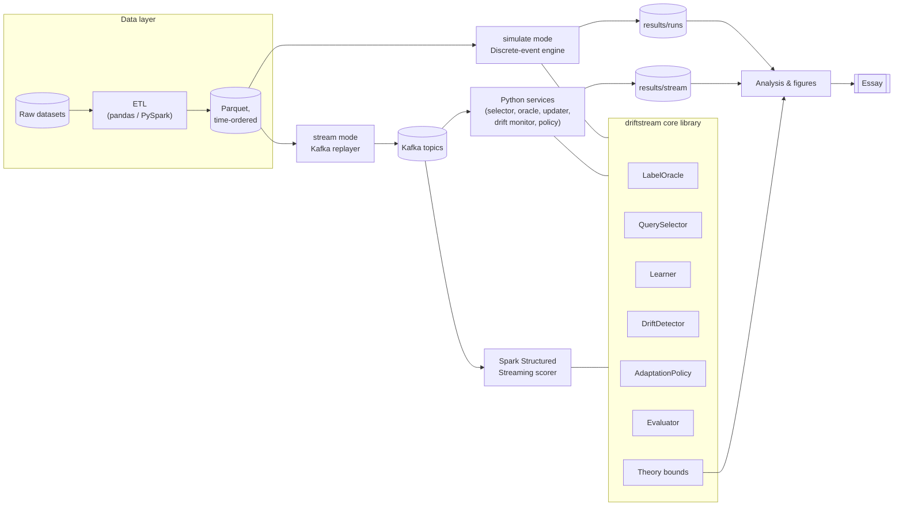
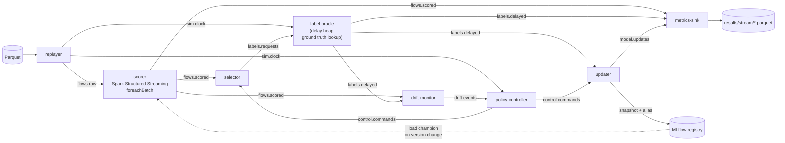

<!-- ARCHITECTURE.md -->

# DriftStream-IDS — ARCHITECTURE

> **Working title of the essay:** _Verification Latency: Why Concept-Drift
> Adaptation in Streaming Network Intrusion Detection Fails When Labels Arrive
> Late_
>
> **Companion documents:** `PROJECT_STRUCTURE.md` (where everything lives),
> `ROADMAP.md` (what gets done, in which order, with which acceptance criteria),
> `docs/theory.md` (full derivations behind §4).
>
> **Language policy:** all code, comments, documentation, configs, commit
> messages and the essay are written in **English**.

---

## Table of contents

1. [Purpose and scope](#1-purpose-and-scope)
2. [Research question, thesis and hypotheses](#2-research-question-thesis-and-hypotheses)
3. [Formal problem model](#3-formal-problem-model)
4. [Theoretical analysis (analytic predictions)](#4-theoretical-analysis-analytic-predictions)
5. [System overview: two execution modes, one library](#5-system-overview-two-execution-modes-one-library)
6. [Core library: components and interfaces](#6-core-library-components-and-interfaces)
7. [Discrete-event simulation engine](#7-discrete-event-simulation-engine)
8. [Data architecture](#8-data-architecture)
9. [Learners, detectors, selectors and policies](#9-learners-detectors-selectors-and-policies)
10. [Evaluation framework and metrics](#10-evaluation-framework-and-metrics)
11. [Experiment design (E0–E6)](#11-experiment-design-e0e6)
12. [Statistical analysis plan](#12-statistical-analysis-plan)
13. [Streaming deployment architecture (Kafka–Spark)](#13-streaming-deployment-architecture-kafkaspark)
14. [Model lifecycle, registry and promotion gate](#14-model-lifecycle-registry-and-promotion-gate)
15. [Reproducibility architecture](#15-reproducibility-architecture)
16. [Governance, standards and regulatory mapping](#16-governance-standards-and-regulatory-mapping)
17. [Security considerations of the pipeline itself](#17-security-considerations-of-the-pipeline-itself)
18. [Threats to validity](#18-threats-to-validity)
19. [Architecture Decision Records (ADR) summary](#19-architecture-decision-records-adr-summary)
20. [Mapping: architecture → essay sections](#20-mapping-architecture--essay-sections)
21. [Glossary](#21-glossary)
22. [Design references](#22-design-references)

---

## 1. Purpose and scope

### 1.1 Purpose

DriftStream-IDS is a **reproducible research artefact** that backs a 9-page
(~2,500 words) research essay. Its job is to turn one claim into something that
can be **derived analytically, measured empirically and demonstrated in a
running streaming system**:

> Most concept-drift adaptation methods for ML-based network intrusion detection
> (NIDS) are evaluated under the assumption that ground-truth labels arrive
> **immediately and for free**. Security Operations Centres (SOCs) deliver
> labels **late (verification latency `D`)** and **for a small fraction of
> traffic (labelling budget `B`)**. Under those conditions, the delay `D` acts
> as an **additive, irreducible floor** on recovery time for any label-dependent
> adaptation, while the budget only scales the remaining term.

### 1.2 What the artefact delivers

| Deliverable                                    | Role in the essay                                     |
| ---------------------------------------------- | ----------------------------------------------------- |
| Closed-form predictions (`driftstream.theory`) | Section 3 "The Bottleneck": the analytic floor        |
| Deterministic simulator (`simulate` mode)      | Evidence: D×B grids, regret curves, hypothesis tests  |
| Kafka–Spark deployment (`stream` mode)         | Evidence of practical validity: parity and throughput |
| Figures and tables (`results/`)                | Figure 1 (theory vs. empirical), Table 2 (D×B)        |
| Pre-registration (`docs/preregistration.md`)   | Methodological rigour, falsifiability                 |

### 1.3 In scope

- Binary flow-level intrusion detection (benign vs. attack). Attack family is
  kept as metadata for per-family analysis.
- Two datasets: **CIC-IDS2017 (corrected, DistriNet/KU Leuven)** and **Kyoto
  2006+**, plus synthetic streams for theory validation.
- Online (River) and periodic batch (scikit-learn) learners.
- Supervised (ADWIN, DDM) and unsupervised (KS on scores, MMD on features) drift
  detectors.
- Label-delay models (constant, log-normal), budgeted query selection (random,
  hybrid uncertainty) and adaptation policies (periodic, on-detect, budget
  burst, promotion gate).
- A dockerised Kafka–Spark pipeline that runs **the same library code**.

### 1.4 Out of scope (explicitly)

- Multi-class attack-family classification as the main target.
- Adversarial/poisoning attacks on the label channel (documented as future work
  in §17).
- Packet-level deep learning, encrypted-traffic analysis.
- Production hardening (authN/Z, TLS, HA). The pipeline is a research testbed,
  bound to localhost.
- Cross-dataset transfer (UNSW-NB15 → CIC) — kept as a **stretch** item in the
  roadmap, not part of the MVP.

---

## 2. Research question, thesis and hypotheses

### 2.1 Research question (RQ)

> _How much post-drift detection performance can a streaming flow-based NIDS
> recover when ground-truth labels arrive with realistic delays and under a
> fixed analyst labelling budget, compared with the immediate-label assumption
> used in most drift-adaptation studies?_

### 2.2 Thesis (to be supported or refuted)

Recovery time after a drift is lower-bounded by `D + (m_a − C)⁺ / (B·λ)`, where
`C` is the token-bucket capacity (the most labels that can be saved for later;
`docs/theory.md` §5.2). The term `D` cannot be reduced by better detectors,
larger budgets or budget bursts. Only **label-free adaptation** or **shorter
verification pipelines** can reduce it.

### 2.3 Hypotheses (frozen in `docs/preregistration.md` at milestone M3, tag `prereg-v1`)

The exact decision rules are in `docs/preregistration.md` §2; this table is a
summary.

| ID                     | Hypothesis                                                                                                                                                              | Primary experiment | Decision rule (summary)                                                                                              |
| ---------------------- | ----------------------------------------------------------------------------------------------------------------------------------------------------------------------- | ------------------ | -------------------------------------------------------------------------------------------------------------------- |
| **H1**                 | The detection delay of a supervised detector grows linearly with `D` (slope ≈ 1) and with `1/(ρ·B)`                                                                     | E0, E3, E1         | 95 % CI of the OLS slope on `D` contains 1 (E0); prediction error ≤ 25 % (E0); positive and significant on E1        |
| **H2**                 | The detection delay of an unsupervised detector (KS on scores) is invariant to `D` and `B`, **provided the drift changes `P(x)`**                                       | E0, E1, E3         | Equivalence test (TOST) on the slopes; the SEA control (pure `P(y\|x)` drift) is expected **not** to be detected     |
| **H3**                 | The recovery time of any label-dependent adaptation has an additive floor `D`: `τ_rec ≥ D + (m_a − C)⁺/(B·λ)` (log-normal variants: expected floor of `theory.md` §5.5) | E0, E1, E2, E3     | ≥ 95 % of runs satisfy the bound (with tolerance); median relative error of the prediction ≤ 25 % on E0              |
| **H4**                 | Label-latency regret grows ≈ linearly with `D`; a budget burst after unsupervised detection reduces regret only through label collection, by at most `Δε·C/B`           | E1, E2, E4         | Regression of regret on `D` is linear (R² ≥ 0.8 on E0/E3); burst gain is invariant to `D` (TOST) and below the bound |
| **H5** _(exploratory)_ | Uncertainty-based selection reduces `m_a` relative to random selection, but biases the supervised error estimate (hence the hybrid split `ρ`)                           | E1, E4             | Reported descriptively with CIs; no confirmatory claim                                                               |

All hypotheses are **directional and falsifiable**. A refuted hypothesis is
reported as a finding, not hidden.

### 2.4 Novelty statement (careful wording for the essay)

Verification latency is a known concept in the general data-stream literature
(Marrs et al. 2010; Souza et al. 2015; Grzenda et al. 2020). The contribution
here is **not** the concept. It is:

1. an explicit analytic floor that combines delay, budget and detector
   statistics, applied to NIDS;
2. its empirical quantification on corrected, time-ordered NIDS data with
   natural (Kyoto) and family-arrival (CIC) drift;
3. a demonstration that the conclusions hold in a running Kafka–Spark pipeline.

---

## 3. Formal problem model

### 3.1 Notation

| Symbol                                              | Meaning                                                                |
| --------------------------------------------------- | ---------------------------------------------------------------------- |
| $x_i \in \mathbb{R}^d$                              | Feature vector of flow $i$                                             |
| $t_i$                                               | Event timestamp of flow $i$ (UTC, from the dataset)                    |
| $y_i \in \{0,1\}$                                   | Ground truth (0 = benign, 1 = attack)                                  |
| $f_i$                                               | Attack family (metadata only)                                          |
| $\lambda$                                           | Flow arrival rate (flows per second of event time)                     |
| $h_t$                                               | Model in production at time $t$                                        |
| $s_i = h_{t_i}(x_i)$                                | Attack score in $[0,1]$                                                |
| $\hat y_i = \mathbb{1}[s_i \ge \theta]$             | Decision, threshold $\theta$ (default 0.5)                             |
| $q_i \in \{0,1\}$                                   | Whether a label is requested for flow $i$                              |
| $B$                                                 | Labelling budget: long-run fraction of flows queried                   |
| $C$                                                 | Token-bucket capacity (tokens = labels that can be saved)              |
| $\rho$                                              | Share of the budget spent on **random** queries (rest: uncertainty)    |
| $\delta_i$                                          | Verification delay of flow $i$; $\delta_i \sim \mathcal{D}(D)$         |
| $D$                                                 | Mean verification delay                                                |
| $t_0$                                               | Drift onset                                                            |
| $\varepsilon_0, \varepsilon_1$                      | Pre-/post-drift error rate of the pre-drift model                      |
| $\Delta\varepsilon = \varepsilon_1 - \varepsilon_0$ | Error jump caused by the drift                                         |
| $n^\*$                                              | Post-drift random-substream labels a supervised detector needs to fire |
| $m_a$                                               | Post-drift labels the learner needs to re-attain oracle-level error    |
| $w$                                                 | Window sizes (evaluation, KS test windows)                             |

### 3.2 Information flow (what each actor may see)

```
flow arrives (t_i, x_i) ──► model scores s_i ──► decision ŷ_i
          │                         │
          │                         └──► selector decides q_i (budget B, split ρ)
          │                                     │ if q_i = 1
          │                                     ▼
          │                         oracle releases y_i at t_i + δ_i
          │                                     │
          │                                     ▼
          │                  learner / supervised detector consume (x_i, y_i)
          │
          └──► EVALUATOR sees ALL y_i immediately (measurement only, never
               fed back to the learner)
```

**Golden rule (enforced by tests):** the evaluator's labels are never visible to
the learner, the selector, the detectors or the policies. Only the oracle's
delayed, budgeted labels are.

### 3.3 Budget semantics

The budget is enforced by a **token bucket**:

- Each arriving flow adds $B$ tokens. The bucket is capped at $C$ (default $C =
  50$ tokens, configurable).
- A query consumes 1 token. A query is allowed only if tokens ≥ 1.
- This guarantees $\sum_{j \le i} q_j \le B \cdot i + C$ for every prefix $i$
  (the hard constraint, property-tested). It also allows **saving** tokens for a
  budget burst (§9.4). The same guarantee bounds every burst: in any interval of
  length $t$ at most $B\lambda t + C$ labels are queried (`docs/theory.md`
  §5.2–§5.3).

### 3.4 Delay models

| Model                  | Definition                                                                    | Parameters                 |
| ---------------------- | ----------------------------------------------------------------------------- | -------------------------- |
| `constant`             | $\delta_i = D$                                                                | `D`                        |
| `lognormal`            | $\delta_i \sim \text{LogNormal}(\mu, \sigma)$ with $e^{\mu + \sigma^2/2} = D$ | `D`, `sigma` (default 1.0) |
| `empirical` _(future)_ | Sampled from a measured SOC ticket-closure distribution                       | path to CDF file           |

Log-normal delays model the heavy-tailed ticket-closure times of real SOCs: the
median delay is $D e^{-\sigma^2/2}$ (≈ 0.61 D for σ = 1), and a few labels take
much longer than `D`.

### 3.5 Drift taxonomy used in the project

| Type                         | What changes             | Visible to unsupervised detectors? | Where it occurs                               |
| ---------------------------- | ------------------------ | ---------------------------------- | --------------------------------------------- |
| Virtual drift                | $P(x)$ only              | Yes                                | Kyoto (traffic mix), synthetic Gaussian shift |
| Real drift                   | $P(y \mid x)$ only       | **No** (scores unchanged)          | SEA control stream                            |
| Mixed (novel attack arrival) | $P(x)$ and $P(y \mid x)$ | Yes                                | CIC family onsets, injected ablation          |
| Prior drift                  | $P(y)$                   | Partially                          | Kyoto (attack share varies over years)        |

---

## 4. Theoretical analysis (analytic predictions)

The theory is implemented in `src/driftstream/theory/` (`bounds.py`,
`adwin_replay.py`, `from_config.py`) and derived step by step in
`docs/theory.md`. It is validated on synthetic data (E0) **before** real-data
experiments are run. `driftstream theory predict` prints every prediction for a
Hydra config plus the measured stream quantities.

### 4.1 Assumptions (stated explicitly in the essay)

- **A1 — Abrupt drift:** at $t_0$ the pre-drift model's error jumps from
  $\varepsilon_0$ to $\varepsilon_1$ and stays there until adaptation.
- **A2 — Stationary arrivals:** flows arrive at rate $\lambda$ (relaxed in
  E1/E2, where $\lambda(t)$ is empirical).
- **A3 — Delay:** constant delay $D$ (log-normal is tested as a robustness
  variant, with its own expected floor, §4.4).
- **A4 — Random detection substream:** the supervised detector uses only the
  random share $\rho B$ of queries, so its error estimate is unbiased.
- **A5 — Token bucket:** at most $B\lambda t + C$ queries in any interval of
  length $t$.
- **A6 — Step recovery:** retraining on $m_a$ post-drift labels restores
  oracle-level error ($m_a$ absorbs the learning curve).

### 4.2 Supervised detection delay (H1)

No post-drift label exists before $t_0 + D$. Post-drift labels from the random
substream then arrive at rate $\rho B \lambda$. River's ADWIN tests, every
`clock` updates, every bucket boundary of its exponential histogram as a split
$W = W_0 W_1$ and fires when $|\mu_{W_0} - \mu_{W_1}| > \varepsilon_{cut}$, with

$$
\varepsilon_{cut} = \sqrt{2\, m^{-1} \sigma_W^2\, \delta'} +
\tfrac{2}{3}\, \delta'\, m^{-1}, \qquad
m^{-1} = \frac{1}{n_0 - L + 1} + \frac{1}{n_1 - L + 1},\;
\delta' = \ln\frac{2 \ln |W|}{\delta},
$$

where $L$ is `min_window_length` and $\sigma_W^2$ the variance of the whole
window. This is the rule of River 0.27, verified by a Python port that fires on
exactly the same indices as River's ADWIN (`tests/unit/test_adwin_replay.py`).
`adwin_replay.n_star` computes $n^\*$ by a **mean-field replay** of that rule
(expected Bernoulli statistics, exact bucket boundaries, check clock averaged
over its phase). It matches River Monte Carlo within ≈ 5 % without censoring,
whereas the first-order approximation $n^\* \propto
\ln(1/\delta)/\Delta\varepsilon^2$ is off by up to 2.7× (`docs/theory.md` §3.3).
Because the replay already includes the check clock:

$$
\boxed{\;\mathbb{E}[\tau^{sup}_{det}] \approx D + \frac{n^\*}{\rho B \lambda}\;}
$$

### 4.3 Unsupervised detection delay (H2)

A two-sample KS test compares a reference window of $w_{ref}$ scores (captured
after the last (re)training) with the latest $w_{test}$ scores, every $k$
arrivals, and alarms after $p$ consecutive rejections at level $\alpha$. A test
window with a post-drift share $f$ is the mixture $fF_1 + (1-f)F_0$, whose KS
distance to $F_0$ is exactly $f\,d_{KS}$. Rejection therefore needs $f \ge
c_{KS} = \text{crit}(\alpha, w_{ref}, w_{test}) / d_{KS}$, and

$$
\boxed{\;\mathbb{E}[\tau^{unsup}_{det}] \approx \frac{c_{KS}\,w_{test} + (p - \tfrac12)\,k}{\lambda}\;}
\qquad (\text{worst case: } p\,k)
$$

The bound is **independent of $D$ and $B$**. It does **not** hold for pure real
drift (SEA): there $d_{KS} = 0$ and the prediction is "never".

### 4.4 Recovery time floor (H3)

Adaptation needs $m_a$ post-drift labels. Those labels cannot be released before
$t_0 + D$, and by A5 at most $B\lambda s + C$ of them can be queried within $s$
seconds of the onset. Hence, for **any** label-dependent adaptation, bursts
included:

$$
\boxed{\;\tau_{rec} \;\ge\; D + \frac{(m_a - C)^+}{B\lambda}\;}
$$

With log-normal delays the expected floor is lower (heavy tails also mean early
labels) and is computed in closed form (`docs/theory.md` §5.5;
`bounds.recovery_floor_lognormal`).

Every retrain-on-alarm policy follows one formula. If the policy retrains on
labels of flows with event time $\ge t_0 + o$, it needs $m = \max(m_a, m_{min})$
of them, and it cannot retrain before the alarm:

$$
\tau_{rec} = \max\big(\tau_{det},\; o + D + T_{collect}(m)\big)
$$

| Policy                                     | Label origin `o`                                       | Predicted recovery time                                                                                                                |
| ------------------------------------------ | ------------------------------------------------------ | -------------------------------------------------------------------------------------------------------------------------------------- |
| Supervised on-detect reset (ODS)           | labels arriving after the alarm ($o = \tau_{det} - D$) | $\tau_{rec} \approx D + \frac{n^\*}{\rho B\lambda} + \frac{m_a}{B\lambda}$                                                             |
| Unsupervised on-detect (ODU)               | flows after the alarm ($o = \tau_{det}$)               | $\tau_{rec} \approx \tau^{unsup}_{det} + D + \frac{m_a}{B\lambda}$ (to be fixed in T3.6 once the KS change-time estimate exists; OD-2) |
| ODU + budget burst ×k for horizon H        | flows after the alarm                                  | $\tau_{rec} \approx \tau^{unsup}_{det} + D + T_{collect}(k, H, C)$; the gain over ODU is **at most $C/(B\lambda)$, whatever $k$**      |
| Continuous online learning (ARF, no reset) | —                                                      | $\tau_{rec} \gtrsim D + \frac{m_a^{ARF}}{B\lambda}$ (ARF's internal detectors are also label-driven)                                   |
| Periodic (period $T$)                      | —                                                      | $D + \frac{m_a}{B\lambda} + T/2$                                                                                                       |

**Key insight:** a burst speeds up label **collection**, not label
**verification**, and it can only spend the $C$ labels saved before the drift.
$D$ survives every policy that waits for labels.

### 4.5 Label-latency regret (H4)

Regret is defined against an oracle learner that has $D = 0$ and $B = 1$:

$$
R(D, B) = \sum_i \left(\ell_i^{(D,B)} - \ell_i^{oracle}\right),
\qquad \ell_i = \mathbb{1}[\hat y_i \ne y_i].
$$

Under A1–A6, $R \approx \lambda\,\Delta\varepsilon\,\tau_{rec}$, which is
**linear in $D$** (slope $\lambda\Delta\varepsilon$) and decreasing as $1/B$ in
its second term. A burst lowers $R$ by at most $\Delta\varepsilon\,C/B$ excess
errors, independently of $D$. Regret is reported per 1,000 flows, so values are
comparable across datasets.

### 4.6 What would falsify the thesis

- Recovery systematically **faster** than the floor for a label-dependent policy
  → a hidden label leak, or the drift is not abrupt (gradual drift lets the
  model adapt before $t_0$).
- Supervised detection insensitive to $D$ → detection is driven by something
  other than labels (bug, or ARF internal resets triggered by pre-drift noise).
- A burst gain above $C/(B\lambda)$ → a budget leak in the token bucket.
- All are checked explicitly in E0/E3/E4 and in the leak tests (§15.4); the full
  list is `docs/theory.md` §8.

---

## 5. System overview: two execution modes, one library



| Aspect            | `simulate` mode                         | `stream` mode                               |
| ----------------- | --------------------------------------- | ------------------------------------------- |
| Purpose           | Science: fast, deterministic, many runs | Practical validity: real streaming          |
| Clock             | Event time, discrete-event queue        | Event time carried in messages + wall clock |
| Determinism       | Bit-for-bit given seed + config         | Statistical (micro-batching, scheduling)    |
| Throughput target | As fast as Python allows                | Measured (E6)                               |
| Used by           | E0–E4                                   | E5 (parity), E6 (throughput/latency)        |
| Code reuse        | 100 % of the core library               | Same classes, wrapped in services           |

**Design principle:** nothing scientific is implemented twice. The services in
`stream` mode are thin adapters around the same `Learner`, `QuerySelector`,
`LabelOracle`, `DriftDetector` and `AdaptationPolicy` objects used by the
simulator.

---

## 6. Core library: components and interfaces

All interfaces are `typing.Protocol` classes in
`src/driftstream/core/interfaces.py`. Concrete implementations live in their own
sub-packages (see `PROJECT_STRUCTURE.md`).

### 6.1 Domain types (`core/types.py`)

```python
@dataclass(frozen=True, slots=True)
class Flow:
    flow_id: int  # stable, dataset-unique
    event_time: float  # epoch seconds, UTC
    x: dict[str, float | str]
    y: int  # ground truth (evaluator / oracle only)
    family: str  # "BENIGN", "DoS-Hulk", ... (metadata)


@dataclass(frozen=True, slots=True)
class Prediction:
    flow_id: int
    event_time: float
    score: float
    pred: int
    model_version: int


@dataclass(frozen=True, slots=True)
class LabelRequest:
    flow_id: int
    event_time: float
    score: float
    pred: int
    reason: Literal["random", "uncertainty", "burst"]


@dataclass(frozen=True, slots=True)
class DelayedLabel:
    flow_id: int
    event_time: float  # when the flow happened
    release_time: float  # when the label becomes visible
    x: dict[str, float | str]
    y: int
    pred: int
    score: float
    reason: str


@dataclass(frozen=True, slots=True)
class DriftAlarm:
    detector: str
    detected_at: float  # event time of the alarm
    estimated_change_time: float  # change-point estimate
    statistic: float
    p_value: float | None
```

> `Flow.y` is accessed only by `Evaluator` and `LabelOracle`. A unit test fails
> if any other module reads it (AST-based check, §15.4).

### 6.2 Interfaces

```python
class Learner(Protocol):
    name: str
    version: int

    def predict_proba_one(self, x: dict) -> float: ...
    def learn_one(self, x: dict, y: int) -> None: ...
    def fit_batch(self, X: list[dict], y: list[int]) -> None: ...
    def reset(self) -> None: ...
    def snapshot(self) -> bytes: ...  # for the registry
    @classmethod
    def restore(cls, blob: bytes) -> "Learner": ...


class QuerySelector(Protocol):
    def decide(self, pred: Prediction, now: float) -> LabelRequest | None: ...
    def set_burst(self, factor: float, until: float) -> None: ...
    @property
    def labels_spent(self) -> int: ...


class LabelOracle(Protocol):
    def request(self, req: LabelRequest, flow: Flow) -> None: ...
    def release_until(self, now: float) -> list[DelayedLabel]: ...


class DriftDetector(Protocol):
    name: str
    kind: Literal["supervised", "unsupervised"]

    def update_prediction(self, pred: Prediction) -> DriftAlarm | None: ...
    def update_label(self, lab: DelayedLabel) -> DriftAlarm | None: ...
    def reset(self, now: float) -> None: ...


class AdaptationPolicy(Protocol):
    def on_tick(self, now: float, ctx: "PolicyContext") -> list["Action"]: ...
    def on_alarm(
        self, alarm: DriftAlarm, ctx: "PolicyContext"
    ) -> list["Action"]: ...
    def on_label(
        self, lab: DelayedLabel, ctx: "PolicyContext"
    ) -> list["Action"]: ...


class Evaluator(Protocol):
    def record(self, flow: Flow, pred: Prediction) -> None: ...
    def record_event(self, kind: str, t: float, payload: dict) -> None: ...
    def finalize(self) -> "RunResult": ...
```

### 6.3 Actions (policy output)

| Action                 | Effect                                                   |
| ---------------------- | -------------------------------------------------------- |
| `LearnOne(lab)`        | Incremental update of the learner                        |
| `Buffer(lab)`          | Append to the labelled buffer (batch learners)           |
| `Retrain(since=t̂)`     | Fit a candidate on buffered labels with `event_time ≥ t̂` |
| `Promote(candidate)`   | Swap the production model (after the gate)               |
| `ResetDetector()`      | Reset detector state and reference windows               |
| `Burst(factor, until)` | Raise the selector's query rate (token-bucket financed)  |

Policies return actions and **never mutate state directly**. The engine (or the
stream service) applies the actions. This keeps the policies pure, testable and
identical across both modes.

---

## 7. Discrete-event simulation engine

### 7.1 Event types and priority

| Event          | Priority (lower = first at equal time) | Source                                         |
| -------------- | -------------------------------------- | ---------------------------------------------- |
| `LabelRelease` | 0                                      | Oracle heap                                    |
| `PolicyTick`   | 1                                      | Scheduler (every `tick_seconds` of event time) |
| `FlowArrival`  | 2                                      | Dataset iterator (time-ordered Parquet)        |

Ties are broken by `(time, priority, seq)`, with `seq` a monotonically
increasing counter. Labels released at time `t` are therefore applied **before**
a flow arriving at the same `t` is scored. This rule is documented and tested.

### 7.2 Main loop (pseudocode)

```text
init: learner ← warm_up(train_slice); detectors.reset(); evaluator.start()
heap ← merge(flow_iterator, tick_schedule)
while heap not empty:
    ev ← pop_min(heap)
    match ev:
      LabelRelease(lab):
          for d in supervised_detectors: alarm ← d.update_label(lab); handle(alarm)
          apply(policy.on_label(lab, ctx))
      PolicyTick(t):
          apply(policy.on_tick(t, ctx))
      FlowArrival(flow):
          s ← learner.predict_proba_one(flow.x)
          pred ← Prediction(flow.flow_id, flow.event_time, s, s ≥ θ, learner.version)
          evaluator.record(flow, pred)                     # test-then-train
          for d in unsupervised_detectors: alarm ← d.update_prediction(pred); handle(alarm)
          req ← selector.decide(pred, flow.event_time)
          if req: oracle.request(req, flow); push(heap, LabelRelease(release_time))
handle(alarm): if alarm: evaluator.record_event("alarm", ...); apply(policy.on_alarm(alarm, ctx))
end: evaluator.finalize() → RunResult (Parquet + manifest)
```

### 7.3 Performance considerations

- Flows are read in Parquet row groups (`pyarrow`) and converted lazily to
  `dict` (River's input format).
- The oracle uses `heapq`; memory is bounded by `λ · B · max_delay`.
- Per-flow logging is columnar (Arrow record batches flushed every 50k rows).
- Target throughput: ≥ 2,000 flows/s for ARF (10 trees) on one core. The real
  figure is measured in Phase 3 and feeds the compute budget (§11.8).
- Grid parallelism: `joblib` (process pool) locally. An optional **Spark batch
  runner** distributes independent runs as Spark tasks (one run = one task).
  This uses Spark for embarrassingly parallel sweeps, a legitimate use that is
  separate from the streaming layer.

### 7.4 Cross-check with River's built-in delayed evaluation

River's `evaluate.progressive_val_score` supports a `delay` argument. For
`B = 1` (every label returned) and constant `D`, the simulator's prequential
metrics must match River's within numerical tolerance (integration test
`test_parity_with_river_delay.py`). This independently validates the engine.

---

## 8. Data architecture

### 8.1 Datasets

| Dataset                     | Source                                                                                                                     | Period                                                      | Why it is used                                                        | Drift character                                |
| --------------------------- | -------------------------------------------------------------------------------------------------------------------------- | ----------------------------------------------------------- | --------------------------------------------------------------------- | ---------------------------------------------- |
| **CIC-IDS2017 (corrected)** | DistriNet / KU Leuven re-generation (Engelen et al., WTMC/SPW 2021) of the CIC dataset (Sharafaldin et al. 2018)           | 5 working days, July 2017                                   | Known onset of each attack family, so detection delay is measurable   | Mixed drift: new families arrive on known days |
| **Kyoto 2006+**             | Kyoto University honeypot data (Song et al. 2011), `takakura.com/Kyoto_data/new_data201704/` (2006-11 → 2015-12 available) | Multi-year (MVP window: 2007-01 → 2009-12, ≈ 3.9 GB zipped) | Natural, long-horizon drift; enables realistic delays (hours to days) | Virtual + prior drift, gradual and abrupt      |
| **Synthetic (E0)**          | River generators + custom Gaussian generator                                                                               | Configurable                                                | Exact control of $t_0$, $\Delta\varepsilon$, $\lambda$                | Abrupt, controlled                             |

> **Never use the original, uncorrected CIC-IDS2017 CSVs.** Engelen et al.
> report that more than 20 % of the original traffic traces had to be
> reconstructed or relabelled. Arp et al. (2022) list this class of error among
> the pitfalls that invalidate results.

### 8.2 Canonical schema (`data/processed/<dataset>/flows.parquet`)

| Column       | Type               | Notes                                      |
| ------------ | ------------------ | ------------------------------------------ |
| `flow_id`    | int64              | Dense, assigned after time-sorting         |
| `event_time` | float64            | Epoch seconds, **UTC** (normalised in ETL) |
| `day`        | date               | Partition column                           |
| `y`          | int8               | 0 benign, 1 attack                         |
| `family`     | string             | Normalised family name                     |
| `label_raw`  | string             | Original label (traceability)              |
| `f_*`        | float32 / category | Features (prefix `f_`)                     |

Side files per dataset:

- `drift_onsets.json`: family → first `event_time` (computed, not assumed).
- `feature_profile.json`: feature list per profile (see §8.4).
- `stats.json`: counts per day and family, λ per hour, class ratio.
- `CHECKSUMS.sha256`: hashes of the raw inputs and processed outputs.

### 8.3 ETL pipelines

**CIC-IDS2017 corrected** (`etl/cicids2017.py`, pandas, fits in RAM):

1. Download the per-day CSVs; verify SHA-256 against `data/CHECKSUMS.raw`.
2. Parse timestamps; **check timezone and AM/PM consistency** (a known problem
   in the original release). Normalise to UTC and assert that timestamps
   increase monotonically within each day after sorting.
3. Map labels: `BENIGN → 0`; attack labels → 1. Flows labelled
   `"<family> - Attempted"` are mapped by `attempted_policy` ∈ {`benign`
   (default), `attack`, `drop`} → **ablation A-ATT**.
4. Drop identifiers (`Flow ID`, `Src IP`, `Dst IP`, `Src Port`, `Timestamp` as a
   feature).
5. Remove exact duplicate feature-and-label rows **within the same second**
   (duplicate counts are logged). Replace inf with NaN, then impute the median
   of the **warm-up slice only** (no look-ahead).
6. Sort by `event_time`, assign `flow_id`, write Parquet partitioned by day.
7. Optional uniform subsampling with fraction `subsample` (same fraction for all
   classes, so prevalence and temporal structure are preserved).

**Kyoto 2006+** (`etl/spark_kyoto_etl.py`, **PySpark batch**, because the raw
text files are large):

1. Read the daily tab-separated files for the configured window (unzipped from
   the provider's monthly archives); the date is taken from the file name and
   `Start_Time` gives the time of day.
2. Build `event_time = date + Start_Time` (the timezone of the honeypot logs is
   documented in ETL notes and normalised to UTC).
3. Label: `1 → 0 (benign)`; `-1` (known attack) and `-2` (unknown attack) `→ 1`.
   `family ∈ {BENIGN, KNOWN, UNKNOWN}`.
4. **Leakage removal (mandatory):** drop `IDS_detection`, `Malware_detection`
   and `Ashula_detection` (they are outputs of other detectors), plus the
   source/destination IP addresses and the source port.
5. Deterministic sampling per day (`hash(flow_key, seed) < fraction`) to reach
   the target size (default ≈ 1.5 M sessions for the MVP window).
6. Write time-sorted Parquet partitioned by month; compute `stats.json`.

### 8.4 Feature profiles (shortcut-learning control)

| Profile   | CIC-IDS2017                                       | Kyoto 2006+                                                                 | Purpose                                                           |
| --------- | ------------------------------------------------- | --------------------------------------------------------------------------- | ----------------------------------------------------------------- |
| `default` | CICFlowMeter statistics + `Dst Port` + `Protocol` | 14 statistical features + `Service`, `Flag`, `Protocol`, `Destination_Port` | Main experiments                                                  |
| `strict`  | `default` minus `Dst Port` and `Protocol`         | `default` minus `Destination_Port`                                          | **Ablation A-FEAT**: spurious port shortcuts (Arp et al. pitfall) |

### 8.5 Temporal protocol

| Dataset   | Warm-up (fully labelled, offline)           | Streaming phase    | Drift events                                              |
| --------- | ------------------------------------------- | ------------------ | --------------------------------------------------------- |
| CIC       | Monday (benign) + Tuesday (FTP/SSH-Patator) | Wednesday → Friday | Each new family's first flow (from `drift_onsets.json`)   |
| Kyoto     | First 30 days of the window                 | Remaining months   | Unknown onsets; analysed through regret and change points |
| Synthetic | First `n_warm` samples                      | Rest               | Exact $t_0$                                               |

Families with very few flows in CIC (e.g. Heartbleed, Infiltration, which have
only a few dozen flows) are **excluded from per-onset delay analysis** (too few
samples) but kept in the aggregate metrics. The exclusion threshold is in the
pre-registration (§4.2).

### 8.6 Data versioning

- Raw data is never modified (`data/raw/` is read-only by convention).
- Processed data is reproducible from `make data`. Its identity is the SHA-256
  of the Parquet files, recorded in every run manifest.
- Optional: DVC remote. Not required, because the checksums + ETL code + config
  already define the data deterministically.

### 8.7 Licensing and citation

- CIC-IDS2017: cite Sharafaldin et al. (2018) and the corrected version by
  Engelen et al. (2021); follow the providers' usage terms.
- Kyoto 2006+: cite Song et al. (2011) as requested by the providers.
- Data is **not** redistributed in the repository; only download scripts and
  checksums are.

---

## 9. Learners, detectors, selectors and policies

### 9.1 Learners

| ID       | Learner                                          | Library                                       | Key defaults                                                                | Role                       |
| -------- | ------------------------------------------------ | --------------------------------------------- | --------------------------------------------------------------------------- | -------------------------- |
| `static` | Model fitted on the warm-up slice, never updated | scikit-learn HGB                              | `max_iter=300`                                                              | Lower bound                |
| `arf`    | Adaptive Random Forest (Gomes et al. 2017)       | River `forest.ARFClassifier`                  | `n_models=10`, `seed` from run seed, internal ADWIN warning/drift detectors | Main online learner        |
| `batch`  | Sliding-window retrain                           | scikit-learn `HistGradientBoostingClassifier` | buffer `20_000` labels, `max_iter=200`, class-balanced weights              | Main batch learner         |
| `oracle` | `arf` with `D = 0`, `B = 1`                      | River                                         | —                                                                           | Upper reference for regret |

Notes:

- River consumes `dict` features and handles nominal features natively in
  Hoeffding trees. scikit-learn gets an `OrdinalEncoder` fitted on the warm-up
  slice (unknown categories → a reserved code).
- `arf` adapts internally even without an external detector. The `detector=none`
  arm therefore measures **ARF's own** label-driven adaptation, which is also
  subject to $D$.
- Class imbalance: the online learner is left as is (prequential metrics are
  macro-averaged); the batch learner uses balanced sample weights.

### 9.2 Drift detectors

| ID             | Kind         | Input                                                  | Defaults                                                                       | Priority |
| -------------- | ------------ | ------------------------------------------------------ | ------------------------------------------------------------------------------ | -------- |
| `none`         | —            | —                                                      | —                                                                              | P0       |
| `adwin`        | Supervised   | Error bits of **random-substream** labels              | `delta=0.002`, `clock=32`                                                      | P0       |
| `ddm`          | Supervised   | Same                                                   | River `drift.binary.DDM` defaults                                              | P1       |
| `ks_scores`    | Unsupervised | Model scores                                           | `w_ref=5000`, `w_test=1000`, `check_every=500`, `alpha=0.001`, `persistence=2` | P0       |
| `mmd_features` | Unsupervised | Standardised features, random Fourier features (D=256) | permutation test, 200 perms, subsample 500                                     | P2       |

The unsupervised reference window is **re-captured after every promotion**,
because the score distribution depends on the model.

### 9.3 Query selectors

| ID            | Rule                                                                                                                                                          | Notes                      |
| ------------- | ------------------------------------------------------------------------------------------------------------------------------------------------------------- | -------------------------- |
| `random`      | Query with probability $B$ (via token bucket)                                                                                                                 | Unbiased                   |
| `uncertainty` | Variable-uncertainty strategy with randomisation (Žliobaitė et al. 2014): query if $\lvert s - \theta\rvert < u$; $u$ adapts to keep the spending rate at $B$ | Biased toward the boundary |
| `hybrid`      | Share $\rho$ random (feeds supervised detectors), $1 - \rho$ uncertainty                                                                                      | Default $\rho = 0.5$       |

All selectors share the token bucket and support `set_burst(factor, until)`.

### 9.4 Adaptation policies

| ID                      | Trigger                                           | Behaviour                                                                                                                                                                               | Priority |
| ----------------------- | ------------------------------------------------- | --------------------------------------------------------------------------------------------------------------------------------------------------------------------------------------- | -------- |
| `continuous`            | Every delayed label                               | `LearnOne` (online learners only)                                                                                                                                                       | P0       |
| `periodic`              | Every `T` of event time (CIC: 1 h; Kyoto: 7 days) | `Retrain(since=now − window)` on the buffer                                                                                                                                             | P0       |
| `on_detect_sup` (ODS)   | Supervised alarm                                  | Reset/retrain using labels with `event_time ≥ estimated_change_time` once `m_min` are available                                                                                         | P0       |
| `on_detect_unsup` (ODU) | Unsupervised alarm                                | Mark $\hat t$; retrain once `m_min` labels with `event_time ≥ t̂` are available                                                                                                          | P0       |
| `budget_burst`          | ODU alarm                                         | Like ODU + `Burst(k, H)`: query-rate multiplier `k` (default 5) for horizon `H`, financed by saved tokens (long-run budget still `B`; the burst ends when the `C` saved tokens run out) | P1       |
| `gate`                  | Wrapper around any retraining policy              | Promote only if the candidate passes the promotion gate (§14.3)                                                                                                                         | P1       |

`m_min` defaults to 500 labels (CIC) and 300 labels (Kyoto). Its effect on $m_a$
is examined in E0.

---

## 10. Evaluation framework and metrics

### 10.1 Prequential (test-then-train) protocol

Every flow is first scored and recorded with its true label by the evaluator.
Only then may the learner be updated, and only by labels that the oracle has
already released. The evaluator **never** influences the system.

### 10.2 Metric definitions

| Metric                       | Definition                                                                                                                            | Notes                            |
| ---------------------------- | ------------------------------------------------------------------------------------------------------------------------------------- | -------------------------------- |
| Windowed macro-F1            | Macro-F1 over the last $w_{eval}$ = 10,000 predictions; sampled every 1,000 flows                                                     | Primary metric                   |
| Faded macro-F1               | Same with fading factor $\alpha$ = 0.999                                                                                              | Robustness                       |
| Windowed TPR / FPR           | At $\theta = 0.5$                                                                                                                     | Operational view                 |
| FPR@TPR = 0.90               | Computed post hoc per window from stored scores                                                                                       | Threshold-independent alert cost |
| Per-family recall            | Recall per attack family over time                                                                                                    | Shows which drifts hurt          |
| Detection delay $\tau_{det}$ | First alarm in $[t_0, t_0 + H_{match}]$ minus $t_0$; censored if none                                                                 | Known-onset datasets only        |
| Detection rate               | Share of onsets detected within $H_{match}$                                                                                           | Reported with $\tau_{det}$       |
| False alarm rate             | Alarms not matched to an onset, per 24 h of event time                                                                                | Detector cost                    |
| Recovery time $\tau_{rec}$   | First $t > t_0$ after which windowed macro-F1 ≥ $(1-\kappa)\cdot$ oracle macro-F1 for $w_{stab}$ consecutive samples; $\kappa = 0.05$ | Censored if never                |
| Label-latency regret $R$     | §4.5, paired by `flow_id` with the oracle run of the same seed; per 1,000 flows                                                       | Headline metric for H4           |
| Labels consumed              | $\sum q_i$                                                                                                                            | Must be ≤ $B \cdot N + C$        |
| Label efficiency             | Regret reduction vs. `static` per 1,000 labels                                                                                        | Cost-effectiveness               |
| Compute                      | Wall-clock seconds, flows/s                                                                                                           | Feasibility                      |

### 10.3 Censoring

$\tau_{det}$ and $\tau_{rec}$ can be right-censored (never reached before the
next onset or the end of the stream). They are reported as **Kaplan–Meier
medians** with the number of censored cases. Censored runs are never dropped
silently.

### 10.4 Outputs per run

Each run writes `metrics.parquet` (the windowed series), `events.parquet`
(alarms, promotions, bursts, query counts), `summary.json` (scalars),
`theory.json` (the analytic predictions for the run's config) and
`manifest.json` (provenance). The layout is described in `PROJECT_STRUCTURE.md`
§7.

---

## 11. Experiment design (E0–E6)

### 11.1 Overview

| ID     | Name                                   | Mode     | Purpose                                                             | Hypotheses  |
| ------ | -------------------------------------- | -------- | ------------------------------------------------------------------- | ----------- |
| **E0** | Theory validation (synthetic)          | simulate | Check the analytic predictions on controlled drift                  | H1–H4       |
| **E1** | CIC-IDS2017 grid                       | simulate | Main factorial on known-onset drift                                 | H1–H5       |
| **E2** | Kyoto 2006+ grid                       | simulate | Main factorial on natural, long-horizon drift with realistic delays | H3–H5       |
| **E3** | Injected-drift ablation (CIC features) | simulate | Controlled $t_0$ and $\Delta\varepsilon$ on real features           | H1–H3       |
| **E4** | Policy comparison                      | simulate | ODS vs. ODU vs. burst vs. gate at fixed $(D, B)$                    | H4, H5      |
| **E5** | Streaming parity                       | stream   | Same results in Kafka–Spark as in the simulator (within tolerance)  | Validity    |
| **E6** | Throughput and latency                 | stream   | Practical feasibility of the pipeline                               | Feasibility |

### 11.2 E0 — Theory validation

- **Streams:**
  - (a) Gaussian two-class stream with a mean shift at $t_0$ (changes $P(x)$
      and $P(y \mid x)$);
  - (b) River `synth.SEA` with `synth.ConceptDriftStream` (abrupt, `width=1`),
      which only changes $P(y \mid x)$: the negative control for H2.
- **Factors:**
  - $D$ ∈ {0, 250, 500, 1000, 2000, 4000} seconds;
  - $B$ ∈ {0.005, 0.01, 0.02, 0.05};
  - $\rho$ ∈ {0.25, 0.5, 1.0};
  - $\lambda$ = 10 flows/s;
  - $\Delta\varepsilon$ ∈ {0.1, 0.2, 0.3} via shift magnitude
      (`dataset.target_delta_eps`);
  - detector ∈ {`adwin`, `ks_scores`}.
- **Seeds:** 10.
- **Sensitivity (exploratory):** ADWIN δ ∈ {0.0002, 0.002, 0.02}, KS `w_test` ∈
  {500, 1000, 2000} on a base cell (pre-registration §8).
- **Outputs:** predicted vs. observed $\tau_{det}$, $\tau_{rec}$, $R$ (Figure 1
  of the essay); the River Monte Carlo of $n^\*$
  (`adwin_replay.simulate_detection`) as an engine-free reference.

### 11.3 E1 — CIC-IDS2017 grid

| Factor     | Levels                                                                            |
| ---------- | --------------------------------------------------------------------------------- |
| Delay $D$  | 0, 5 min, 30 min, 2 h (constant); plus log-normal variant at 30 min               |
| Budget $B$ | 0.1 %, 1 %, 5 % (+ 100 % reference)                                               |
| Selector   | `random`, `hybrid(ρ=0.5)`                                                         |
| Detector   | `none`, `adwin`, `ks_scores`                                                      |
| Learner    | `arf`, `batch`                                                                    |
| Seeds      | 5 (10 for the headline contrasts)                                                 |
| Policy     | `continuous` (arf) / `periodic` (batch) when detector = none; ODS / ODU otherwise |

Full factorial: 4 × 3 × 2 × 3 × 2 = 144 configurations × 5 seeds = 720 runs,
plus references (`static`, `oracle`) and the log-normal variant.

Why the delays are shorter than in Kyoto: the CIC streaming phase covers about 3
working days, so a 7-day delay would be meaningless there. The delay grid is
therefore relative to the dataset span.

### 11.4 E2 — Kyoto 2006+ grid

Same factors as E1, except:

- $D$ ∈ {0, 1 h, 1 day, 7 days} (+ log-normal at 1 day);
- `periodic` uses T = 7 days.

### 11.5 E3 — Injected-drift ablation

- **Base stream:** CIC benign traffic plus one family held out of the warm-up.
- **Injection:** that family is spliced in from a controlled $t_0$, at a
  controlled prevalence $\pi$ ∈ {1 %, 5 %, 20 %} (which controls
  $\Delta\varepsilon$).
- **Factors:** $D$ × $B$ as in E1; detectors `adwin`, `ks_scores`.
- **Purpose:** exact onset on real feature distributions, bridging E0 and E1.
- **Ablations run here:** A-ATT (attempted-label policy), A-FEAT (`strict`
  feature profile).

### 11.6 E4 — Policy comparison

- **Fixed:** $D$ = mid level (CIC 30 min; Kyoto 1 day) and $B$ = 1 %.
- **Arms:** `continuous`, `periodic`, ODS, ODU, ODU + `budget_burst` (k ∈ {2, 5,
  10}), and each retraining arm with and without `gate`.
- **Bucket capacity:** with the default $C = 50$ the burst gain is bounded by
  $C/(B\lambda)$, which is small next to $m_a/(B\lambda)$. Whether $C$ becomes
  an E4 factor ({50, 500, 5,000} proposed) is open decision OD-1 of the
  pre-registration.
- **Seeds:** 10.
- **Also:** a $D$ sweep for the burst arm, to test the invariance part of H4.

### 11.7 E5 — Streaming parity / E6 — Throughput

|                     | E5 Parity                                                                            | E6 Throughput/latency                                           |
| ------------------- | ------------------------------------------------------------------------------------ | --------------------------------------------------------------- |
| Data                | CIC: Wednesday 09:00–10:00 slice; Kyoto: 30-day slice                                | CIC Wednesday full day                                          |
| Topic partitions    | 1 (global order preserved)                                                           | 1, 3, 6                                                         |
| Micro-batch trigger | 1 s, 5 s, 30 s                                                                       | 1 s, 5 s                                                        |
| Replay speed        | ×60 (CIC), ×3600 (Kyoto)                                                             | Max sustainable                                                 |
| Metrics             | Δ macro-F1 vs. simulator, Δ regret, alarm-time differences                           | Events/s, end-to-end p50/p95/p99 latency, consumer lag, CPU/RAM |
| Acceptance          | Mean absolute Δ windowed macro-F1 ≤ 0.01 at a 1 s trigger; gap reported for 5 s/30 s | Report only (no threshold); identify the bottleneck service     |

The **deployment gap** (how much results drift as the micro-batch interval
grows) is a finding in itself. Model updates in production are batched, which
adds latency on top of $D$.

### 11.8 Compute budget and reduction rules

Hardware: one laptop, Intel Core i9 (20 cores), 32 GB RAM; sweeps use 16 joblib
workers. The estimate is refined after the Phase 3 benchmark:

- CIC at a 25 % subsample: ~3 min per run → 720 runs ≈ 36 CPU-h ≈ 2.5 h
  wall-clock on 16 workers.
- Kyoto at 1.5 M sessions: ~8 min per run → 720 runs ≈ 96 CPU-h ≈ 6 h on 16
  workers.

If the budget is exceeded, the following reductions are applied **in this
order** and documented:

1. **R1:** the `batch` learner runs only with `detector ∈ {none, ks_scores}`.
2. **R2:** `hybrid` only, except in E4.
3. **R3:** reduce the Kyoto target size to 1.0 M.
4. **R4:** distribute the runs with the Spark batch runner on additional
   machines.

---

## 12. Statistical analysis plan

1. **Unit of analysis:** (dataset, configuration, seed). Seeds are paired across
   configurations: the same seed gives the same subsample, the same oracle delay
   draws and the same random query decisions wherever possible, via
   `SeedSequence` spawning per component.
2. **Hypothesis-specific tests** (full rules: pre-registration §2):
    - **H1/H2:** OLS of $\tau_{det}$ on $D$ and $1/(\rho B)$; report slopes with
      95 % CIs; cluster-robust SEs by configuration; H2 uses an equivalence test
      (TOST).
    - **H3:** proportion of runs satisfying $\tau_{rec} \ge D + (m_a -
      C)^+/(B\lambda)$ (log-normal variants: the expected floor), with $m_a$
      estimated on calibration seeds disjoint from the analysis seeds; relative
      prediction error distribution.
    - **H4:** regression of $R$ on $D$; burst gain $= R_{ODU} - R_{burst}$
      regressed on $D$ (expected slope ≈ 0) and compared with the bound
      $\Delta\varepsilon\,C/B$.
    - **H5:** descriptive, with bootstrap CIs.
3. **Multi-configuration comparisons:** Friedman omnibus test, then pairwise
   Wilcoxon signed-rank tests with Holm correction (following Demšar 2006 and
   Benavoli et al. 2016, avoiding mean-rank post-hoc tests).
4. **Uncertainty:** 95 % bootstrap CIs (10,000 resamples over seeds; BCa when n
   ≥ 10).
5. **Effect sizes:** Cliff's δ for pairwise comparisons; regret in absolute
   units per 1,000 flows.
6. **Multiple testing:** confirmatory tests only for H1–H4 (pre-registered);
   everything else is labelled exploratory.
7. **Reporting:** every figure shows CIs; every table reports n (runs) and
   censoring counts.

---

## 13. Streaming deployment architecture (Kafka–Spark)

### 13.1 Topology



### 13.2 Services

| Service                        | Tech                                                                                   | Responsibility                                                                                                                         | State                             | Reused library class          |
| ------------------------------ | -------------------------------------------------------------------------------------- | -------------------------------------------------------------------------------------------------------------------------------------- | --------------------------------- | ----------------------------- |
| `kafka`                        | Apache Kafka (KRaft, single node; image tag pinned)                                    | Message bus                                                                                                                            | Log                               | —                             |
| `kafka-init`                   | Kafka CLI                                                                              | Create the topics (§13.3)                                                                                                              | —                                 | —                             |
| `spark-master`, `spark-worker` | Apache Spark (version pinned; `spark-sql-kafka-0-10` matching the Spark/Scala version) | Run the scorer                                                                                                                         | Checkpoints                       | —                             |
| `mlflow`                       | MLflow server (SQLite backend, local artefact volume)                                  | Experiment tracking + model registry                                                                                                   | DB + artefacts                    | —                             |
| `replayer`                     | Python, `confluent-kafka`                                                              | Read Parquet in event-time order; strip `y`/`family`; emit flows at speed ×S; emit `sim.clock` ticks                                   | Cursor                            | `data.loaders`                |
| `scorer`                       | PySpark Structured Streaming                                                           | Parse flows; in `foreachBatch`: reload the champion model if its version changed, score with pandas, publish `flows.scored`            | Model in driver; Spark checkpoint | `Learner`                     |
| `selector`                     | Python                                                                                 | Token bucket + selection rule; publish `labels.requests`                                                                               | Bucket, uncertainty threshold     | `QuerySelector`               |
| `label-oracle`                 | Python                                                                                 | Look up ground truth by `flow_id` (from Parquet, **never** from Kafka); hold labels in a heap; release when `sim.clock ≥ release_time` | Heap                              | `LabelOracle`                 |
| `updater`                      | Python                                                                                 | Apply `LearnOne` / `Buffer` / `Retrain`; run the promotion gate; register snapshots in MLflow; publish `model.updates`                 | Learner, buffer                   | `Learner`, `AdaptationPolicy` |
| `drift-monitor`                | Python                                                                                 | Feed scores to unsupervised detectors and error bits (from labels) to supervised detectors; publish `drift.events`                     | Detector windows                  | `DriftDetector`               |
| `policy-controller`            | Python                                                                                 | Turn alarms and ticks into `control.commands` (retrain, burst, reset)                                                                  | Policy state                      | `AdaptationPolicy`            |
| `metrics-sink`                 | Python                                                                                 | Persist every topic to Parquet for offline evaluation with the **same** `evaluation` module                                            | Files                             | `Evaluator` (offline)         |
| `prometheus`, `grafana` _(P2)_ | —                                                                                      | Live dashboards: lag, throughput, alarms                                                                                               | —                                 | —                             |

### 13.3 Topics

| Topic              | Key          | Partitions (parity / perf) | Retention | Producer → Consumers                                 |
| ------------------ | ------------ | -------------------------- | --------- | ---------------------------------------------------- |
| `flows.raw`        | `flow_id`    | 1 / 3–6                    | 24 h      | replayer → scorer                                    |
| `flows.scored`     | `flow_id`    | 1 / 3–6                    | 24 h      | scorer → selector, drift-monitor, metrics-sink       |
| `labels.requests`  | `flow_id`    | 1                          | 7 d       | selector → label-oracle                              |
| `labels.delayed`   | `flow_id`    | 1                          | 7 d       | label-oracle → updater, drift-monitor, metrics-sink  |
| `drift.events`     | detector     | 1                          | 30 d      | drift-monitor → policy-controller, metrics-sink      |
| `control.commands` | command type | 1                          | 30 d      | policy-controller → updater, selector                |
| `model.updates`    | `model_name` | 1                          | 30 d      | updater → metrics-sink (scorer polls the registry)   |
| `sim.clock`        | constant     | 1                          | 24 h      | replayer → label-oracle, policy-controller, selector |

Stateful services (selector, oracle, updater, drift monitor, policy) consume
single-partition topics, so the order is global and the logic stays identical to
the simulator. Only the stateless scoring path is scaled with partitions (E6).

### 13.4 Message schemas

JSON, validated with pydantic models in `deploy/schemas.py`. Every message
carries `schema_version`.

```json
// flows.raw
{"schema_version": 1, "flow_id": 123, "event_time": 1499173200.12,
 "dataset": "cicids2017", "features": {"f_flow_duration": 512.0, "...": 0}}

// flows.scored
{"schema_version": 1, "flow_id": 123, "event_time": 1499173200.12,
 "score": 0.83, "pred": 1, "model_version": 7, "scored_wall_ms": 1732...}

// labels.requests
{"schema_version": 1, "flow_id": 123, "event_time": 1499173200.12,
 "score": 0.51, "pred": 1, "model_version": 7, "reason": "uncertainty",
 "requested_at": 1499173200.12}

// labels.delayed
{"schema_version": 1, "flow_id": 123, "event_time": 1499173200.12,
 "release_time": 1499175000.12, "y": 1, "pred": 1, "score": 0.51,
 "reason": "uncertainty"}

// drift.events
{"schema_version": 1, "detector": "ks_scores", "detected_at": 1499180000.0,
 "estimated_change_time": 1499179000.0, "statistic": 0.21, "p_value": 1e-6}

// control.commands
{"schema_version": 1, "cmd": "retrain", "since": 1499179000.0}
{"schema_version": 1, "cmd": "burst", "factor": 5, "until": 1499190000.0}

// model.updates
{"schema_version": 1, "model_name": "driftstream-arf", "version": 8,
 "promoted": true, "gate": {"candidate_f1": 0.91, "champion_f1": 0.88}}

// sim.clock
{"schema_version": 1, "event_time": 1499173260.0, "wall_ms": 1732...}
```

The updater obtains feature vectors for labelled flows through the oracle, which
reads them from the same Parquet file as the ground truth. This keeps
`labels.delayed` small; the cost is documented as a simplification of the
testbed.

### 13.5 Time semantics

- **Event time** (from the dataset) drives all scientific logic: label release,
  periodic policies, detector windows, burst horizons.
- **Wall time** is used only for performance metrics (latency, throughput).
- The replayer maps event time to wall time with a speed factor `S`; `sim.clock`
  ticks every `tick_seconds` of event time.
- Spark uses `event_time` as an event-time column with a watermark (default 2
  min of event time) for any windowed aggregation. Scoring itself is stateless
  per record.

### 13.6 Delivery semantics and fault tolerance

- Producers: `enable.idempotence=true`, `acks=all`.
- Consumers: at-least-once; **idempotent processing** through a bounded LRU of
  recently processed `flow_id`s in each stateful service.
- Scorer: Spark checkpoint directory per run, so a restart resumes from the
  committed offsets.
- Stateful Python services snapshot their state every N messages to
  `results/stream/<run>/state/` (enough for a test restart; no HA).

### 13.7 Scorer design detail

```python
def process_batch(df: DataFrame, batch_id: int) -> None:
    global MODEL, MODEL_VERSION
    v = registry.champion_version("driftstream-arf")
    if v != MODEL_VERSION:
        MODEL, MODEL_VERSION = registry.load(v), v  # driver-side
    pdf = df.toPandas()  # micro-batch
    scores = [MODEL.predict_proba_one(x) for x in to_dicts(pdf)]
    out = build_scored(pdf, scores, MODEL_VERSION)
    producer.produce_many("flows.scored", out)
```

- Driver-side scoring is a deliberate choice: River models are small, stateful
  Python objects, and broadcasting them per batch would only add overhead. With
  3–6 partitions in E6, a `mapInPandas` variant that ships a broadcast snapshot
  is benchmarked as an alternative (ADR-008).
- The model version used for each score is recorded, so parity analysis can
  attribute differences to update latency.

### 13.8 Local deployment

- `deploy/docker/docker-compose.yml` with profiles: `core` (kafka, spark,
  mlflow, services), `monitoring` (prometheus, grafana).
- `make stream-up`, `make stream-run EXP=e5_parity_cic`, `make stream-down`.
- Resource target: runs on a laptop with 16 GB RAM (Kafka 1 GB, Spark worker 4
  GB, services ≈ 2 GB); the development laptop has 32 GB.
- All ports bind to `127.0.0.1`.

---

## 14. Model lifecycle, registry and promotion gate

### 14.1 Lifecycle

```
warm-up fit ──► v1 (champion) ──► labels arrive ──► candidate fit
                                                       │
                                     promotion gate ───┤
                                       pass │          │ fail
                                            ▼          ▼
                                  v(n+1) champion   candidate archived
                                                    (reason logged)
```

### 14.2 Registry

- **Simulate mode:** an in-memory registry with the same interface, so the logic
  is identical.
- **Stream mode:** MLflow Model Registry with aliases (`champion`, `candidate`).
  River models are serialised with `cloudpickle` inside a custom `mlflow.pyfunc`
  wrapper; scikit-learn models use `mlflow.sklearn`.
- Every model version records: training label count, the `since`/`until` event
  times, parent version, gate metrics and the config hash.

### 14.3 Promotion gate (P1)

- **Hold-out:** the most recent 20 % (by event time) of the candidate's training
  labels are excluded from fitting.
- **Rule:** promote if `macroF1(candidate) ≥ macroF1(champion) − ε_gate`
  (default `ε_gate = 0.01`) and `FPR(candidate) ≤ FPR(champion) + 0.01`.
- **Fallback:** if the hold-out has fewer than 100 labels or contains a single
  class, the decision is "defer" (retry when more labels arrive).
- **Rationale:** this is the operational form of "validate before promoting",
  the change-management control mapped to ISO/IEC 42001 and AI Act Art. 15 in
  §16. E4 measures its cost in added recovery time.

---

## 15. Reproducibility architecture

### 15.1 Environment

- `uv` manages the project (`pyproject.toml` + `uv.lock`), Python 3.11.
- Ruff for linting and formatting, **line length 80**.
- Docker images pinned by tag in the compose file; the digests are recorded in
  `deploy/docker/IMAGES.lock`.
- Notebooks are stored as `# %%` percent-format `.py` files (jupytext pairing),
  so diffs are readable.

### 15.2 Seeds

One integer `seed` per run is expanded with `numpy.random.SeedSequence` into
independent child streams: `subsample`, `oracle_delay`, `selector`, `learner`,
`detector_perm`. This avoids correlated randomness between components and makes
paired comparisons possible (same `oracle_delay` stream across selectors, for
example).

### 15.3 Run manifest (`manifest.json`)

```json
{
    "run_id": "e1_cic_grid/3f2a9c1d/seed=3",
    "experiment": "e1_cic_grid",
    "config_hash": "3f2a9c1d…",
    "config_resolved": "config.yaml",
    "git_sha": "abc1234",
    "git_dirty": false,
    "data_checksums": { "cicids2017/flows.parquet": "sha256:…" },
    "uv_lock_sha256": "…",
    "python": "3.11.x",
    "platform": "Linux-…",
    "seed": 3,
    "child_seeds": { "oracle_delay": 1234567, "...": 0 },
    "started_utc": "…",
    "finished_utc": "…",
    "wall_seconds": 182.4,
    "flows_processed": 512331,
    "labels_spent": 5121
}
```

### 15.4 Correctness safeguards (automated tests)

| Safeguard          | Test                                                                                                                                         |
| ------------------ | -------------------------------------------------------------------------------------------------------------------------------------------- |
| No label leakage   | AST scan: only `evaluation/` and `oracle/` may access `Flow.y`; a runtime guard object raises if `y` is read elsewhere during the simulation |
| Budget constraint  | Property test (Hypothesis): for random streams, labels spent ≤ $B \cdot i + C$ for every prefix                                              |
| Delay causality    | No `DelayedLabel` is applied before `release_time` (property test)                                                                           |
| Event ordering     | Ties resolved as specified in §7.1                                                                                                           |
| Determinism        | The same config + seed gives byte-identical `summary.json` twice in a row                                                                    |
| Parity with River  | `progressive_val_score(delay=D)` matches the engine at `B = 1`                                                                               |
| ADWIN rule         | A Python port using `theory.adwin_replay.cut_threshold` fires on the same indices as River's ADWIN                                           |
| Theory floor       | Property test: no policy formula in `theory.bounds` beats the recovery floor                                                                 |
| Temporal integrity | ETL asserts monotonic `event_time`; no imputation statistic is computed from post-warm-up data                                               |
| Feature leakage    | Kyoto ETL asserts that the detector-output columns and IPs are absent                                                                        |

### 15.5 Re-running everything

`make all` = `make data` → `make test` → `make e0` … `make e4` →
`make stream-e5 stream-e6` → `make figures tables` → `make essay`. Section 5 of
`ROADMAP.md` gives the order with expected durations.

---

## 16. Governance, standards and regulatory mapping

This section makes the course's governance objective explicit: selecting
frameworks and standards and defining their business use. The dates are **to be
re-verified against primary texts before submission** (see the ROADMAP
source-verification checklist).

### 16.1 Regulatory drivers (Future Prognosis catalysts)

| Instrument                                                                                            | Relevant provision                                                                                                                                              | Why verification latency matters                                                                                                   |
| ----------------------------------------------------------------------------------------------------- | --------------------------------------------------------------------------------------------------------------------------------------------------------------- | ---------------------------------------------------------------------------------------------------------------------------------- |
| NIS2 — Directive (EU) 2022/2555                                                                       | Art. 21 (risk-management measures, incl. incident handling and assessing their effectiveness); Art. 23 (early warning within 24 h, notification within 72 h)    | A detector that cannot recover for `D + …` hours cannot support 24 h/72 h obligations; detection effectiveness must be assessed    |
| Cyber Resilience Act — Reg. (EU) 2024/2847                                                            | Art. 14 reporting of actively exploited vulnerabilities and severe incidents (applies from 11 Sep 2026); full application 11 Dec 2027                           | Time-to-detect becomes a compliance metric for manufacturers                                                                       |
| AI Act — Reg. (EU) 2024/1689, as amended by the Digital Omnibus (Reg. (EU) 2026/1744, to be verified) | Art. 15 (accuracy, robustness, cybersecurity); Art. 72 (post-market monitoring); Annex III point 2 (critical infrastructure) with the deferred application date | **Whether** an ML-NIDS is high-risk must be argued, not assumed; if it is, drift monitoring and documented robustness are required |
| ISO/IEC 42001:2023                                                                                    | AI management system: lifecycle, monitoring, change management                                                                                                  | Promotion gate + run manifests are auditable evidence                                                                              |
| NIST AI RMF 1.0                                                                                       | MEASURE (monitoring of performance and drift), MANAGE                                                                                                           | Regret and recovery time are measurable risk indicators                                                                            |

### 16.2 Security frameworks (operational mapping)

| Framework                  | Element                                                                                                                    | Project artefact                                                              |
| -------------------------- | -------------------------------------------------------------------------------------------------------------------------- | ----------------------------------------------------------------------------- |
| NIST CSF 2.0               | DE.CM (Continuous Monitoring), DE.AE (Adverse Event Analysis), ID.IM (Improvement), GV.OV (oversight)                      | Streaming detection, drift alarms, regret reports                             |
| ISO/IEC 27001:2022 Annex A | 8.16 Monitoring activities; 5.24 Incident management planning; 5.25 Assessment and decision on information security events | The detector, alarm handling, label oracle as a model of the analyst decision |
| MITRE ATT&CK               | See §16.3                                                                                                                  | Per-family recall reported with technique IDs                                 |

### 16.3 CIC-IDS2017 families → MITRE ATT&CK (indicative)

| Family                                          | Technique                               |
| ----------------------------------------------- | --------------------------------------- |
| FTP-Patator, SSH-Patator, Web Brute Force       | T1110 Brute Force                       |
| DoS Hulk / GoldenEye / slowloris / Slowhttptest | T1499 Endpoint Denial of Service        |
| DDoS (LOIC)                                     | T1498 Network Denial of Service         |
| PortScan                                        | T1046 Network Service Discovery         |
| Web XSS, SQL Injection, Heartbleed              | T1190 Exploit Public-Facing Application |
| Botnet (Ares)                                   | T1071 Application Layer Protocol (C2)   |

### 16.4 Business use (for the essay's "actionable advice")

1. Report detection performance **as a function of label delay and budget** in
   vendor evaluations and internal audits. Single-number accuracy figures are
   not enough.
2. Treat **analyst verification time** as a security KPI: it bounds model
   recovery.
3. Invest in label-free adaptation and drift monitoring, and in a **promotion
   gate** for model changes (auditable under ISO/IEC 42001). Saving labelling
   budget for bursts helps only up to the saved amount ($C/(B\lambda)$ seconds
   of recovery).

---

## 17. Security considerations of the pipeline itself

| Topic                    | Status in the testbed                              | Production note                                                                                                                                   |
| ------------------------ | -------------------------------------------------- | ------------------------------------------------------------------------------------------------------------------------------------------------- |
| Kafka authentication/TLS | PLAINTEXT, bound to localhost                      | SASL/SCRAM or mTLS + ACLs per service                                                                                                             |
| Model artefacts          | Pickled River models in a local registry (trusted) | Pickle is an execution vector; use signed artefacts, restricted loaders or safe formats                                                           |
| Label channel integrity  | Trusted oracle                                     | **Label poisoning** by a compromised analyst account or ticketing system is a real threat (future work: robust aggregation, label-noise factor η) |
| Data handling            | Public research datasets; IPs dropped              | Pseudonymise IPs; apply GDPR data minimisation                                                                                                    |
| Secrets                  | None needed (`.env` only for ports)                | Secret manager                                                                                                                                    |
| Supply chain             | `uv.lock`, pinned images                           | SBOM generation (CycloneDX), as also required in spirit by the CRA                                                                                |

---

## 18. Threats to validity

| Type       | Threat                                                                                         | Mitigation                                                                                             |
| ---------- | ---------------------------------------------------------------------------------------------- | ------------------------------------------------------------------------------------------------------ |
| Internal   | Simulated delays and budgets may not resemble real SOC behaviour                               | Constant + log-normal delays; the conclusion proposes measuring a real delay distribution              |
| Internal   | Implementation bugs creating label leaks                                                       | Leak tests (§15.4), parity with River, E0 theory checks                                                |
| Internal   | Hyper-parameter choices (ADWIN δ, KS windows) drive the results                                | Defaults from the literature/libraries; sensitivity sweep on E0                                        |
| Internal   | The analytic floor is fitted to the runs it judges                                             | `m_a` estimated on calibration seeds disjoint from the analysis seeds (pre-registration §4.3)          |
| Construct  | SOCs label **alerts/incidents**, not individual flows                                          | Discussed explicitly; flow-level labels are an optimistic approximation (real delays are likely worse) |
| Construct  | Macro-F1 does not equal operational cost                                                       | FPR@TPR, per-family recall and regret are reported as well                                             |
| Construct  | No label noise                                                                                 | Stretch factor η (label flip rate) in ROADMAP Phase 4                                                  |
| External   | CIC-IDS2017 (2017, lab traffic, 5 days) and Kyoto (2006–2009, honeypot) are dated and specific | Two very different datasets + synthetic; claims are scoped to "flow-based NIDS under these conditions" |
| External   | Kyoto labels come from IDS/honeypot logic (noisy)                                              | Acknowledged; Kyoto is used for temporal dynamics rather than absolute accuracy                        |
| Conclusion | Few seeds, many comparisons                                                                    | Pre-registered confirmatory set, Holm correction, CIs everywhere                                       |
| Deployment | Micro-batching changes update timing                                                           | Quantified as the deployment gap (E5)                                                                  |

---

## 19. Architecture Decision Records (ADR) summary

Full ADRs live in `docs/adr/`. Each has the format: Context → Decision →
Consequences → Alternatives considered.

| ADR     | Decision                                                                                                 | Main reason                                             |
| ------- | -------------------------------------------------------------------------------------------------------- | ------------------------------------------------------- |
| ADR-001 | Science runs in a deterministic discrete-event simulator; Kafka–Spark is used for parity and feasibility | Hundreds of runs must be fast and bit-reproducible      |
| ADR-002 | One core library shared by both modes                                                                    | No duplicated logic; parity is meaningful               |
| ADR-003 | River for online learning and detectors; scikit-learn for batch                                          | Mature, well-cited (Montiel et al. 2021), Python-native |
| ADR-004 | Use only the corrected CIC-IDS2017; never the original CSVs                                              | Documented labelling and construction errors            |
| ADR-005 | Kyoto 2006+ with the detector-output columns removed                                                     | Prevents label leakage                                  |
| ADR-006 | Token-bucket budget with burst support                                                                   | Hard prefix guarantee + enables the burst policy        |
| ADR-007 | Supervised detectors consume only the random share of labels                                             | Unbiased error estimate (H5 trade-off)                  |
| ADR-008 | Driver-side scoring in `foreachBatch` (benchmarked against `mapInPandas`)                                | Small stateful Python models; simplicity                |
| ADR-009 | Single-partition topics for stateful services                                                            | Global order = same semantics as the simulator          |
| ADR-010 | Labels never travel in `flows.raw`; the oracle reads ground truth from storage                           | Realism; the scorer cannot leak labels                  |
| ADR-011 | Hydra configs + config hashing; MLflow for tracking                                                      | Sweeps, provenance, portfolio-grade MLOps               |
| ADR-012 | Pre-register H1–H4 before running E1/E2                                                                  | Prevents HARKing; strengthens the essay                 |
| ADR-013 | PySpark batch for Kyoto ETL and an optional sweep runner                                                 | Large raw files; legitimate parallel workload           |

---

## 20. Mapping: architecture → essay sections

| Essay section (target length)        | Content                                                                                                                                                                                   | Source in the artefact                    |
| ------------------------------------ | ----------------------------------------------------------------------------------------------------------------------------------------------------------------------------------------- | ----------------------------------------- |
| Title + abstract (≈100 words)        | RQ, method, key number, prognosis                                                                                                                                                         | Headline numbers from E1/E2               |
| 1. Introduction & Approach (≈1 page) | Problem, RQ, method (literature filter + analytic model + experiments)                                                                                                                    | §2, §4 summary                            |
| 2. State of the Art (≈3 pages)       | Three families: supervised detection + incremental learning; unsupervised shift detection; active/continual learning. Table of 6 studies with an **"Immediate labels assumed?"** column   | §22 references; ROADMAP essay plan        |
| 3. The Bottleneck (≈1.5 pages)       | The analytic floor, Figure 1 (theory vs. empirical), Table 2 (D×B regret)                                                                                                                 | §4, `docs/theory.md`, E0–E3               |
| 4. Future Prognosis (≈2 pages)       | Catalysts (NIS2, CRA, AI Act, ISO/IEC 42001), 3–5-year outlook (delay- and budget-aware evaluation becomes standard; label-free adaptation + promotion gates in MLOps), actionable advice | §16, E4 (burst/gate), E5/E6 (feasibility) |
| 5. Conclusion (≈1 page)              | Direct answer to the RQ; next study: measure the empirical label-delay distribution in a real SOC for at least 3 months and re-run the grid with it                                       | §3.4 `empirical` delay model              |

---

## 21. Glossary

| Term                       | Definition                                                                     |
| -------------------------- | ------------------------------------------------------------------------------ |
| **Verification latency**   | Time between an event and the availability of its ground-truth label           |
| **Labelling budget**       | Fraction of events for which a label can be obtained                           |
| **Prequential evaluation** | Test-then-train evaluation on a stream                                         |
| **Concept drift**          | Change in $P(x, y)$ over time                                                  |
| **Virtual / real drift**   | Change in $P(x)$ only / in $P(y \mid x)$                                       |
| **Regret**                 | Extra errors relative to an oracle with immediate, complete labels             |
| **Champion / candidate**   | Model in production / model awaiting promotion                                 |
| **Deployment gap**         | Difference between simulator and streaming results due to micro-batching       |
| **Burst**                  | Temporary increase of the query rate financed by saved budget tokens           |
| **Bucket capacity `C`**    | Maximum number of saved tokens; bounds every burst                             |
| **Mean-field replay**      | Evaluating ADWIN's exact decision rule on expected statistics to predict `n*`  |
| **Censoring**              | An event (detection, recovery) not observed before the observation window ends |

---

## 22. Design references

> Verify every bibliographic detail (DBLP / Crossref / publisher page) before
> citing it in the essay. The final 12–15 essay sources are selected in ROADMAP
> Phase 7.

**Core NIDS / ML-security methodology**

- Arp, D. et al. (2022). _Dos and Don'ts of Machine Learning in Computer
  Security._ USENIX Security 2022.
- Engelen, G., Rimmer, V., Joosen, W. (2021). _Troubleshooting an Intrusion
  Detection Dataset: the CICIDS2017 Case Study._ IEEE SPW 2021.
- Liu, L., Engelen, G., Lynar, T., Essam, D., Joosen, W. (2022). _Error
  Prevalence in NIDS datasets: A Case Study on CIC-IDS-2017 and
  CSE-CIC-IDS-2018._ IEEE CNS 2022.
- Apruzzese, G., Laskov, P., Schneider, J. (2023). _SoK: Pragmatic Assessment of
  Machine Learning for Network Intrusion Detection._ IEEE EuroS&P 2023.
- Apruzzese, G. (2026). _SoK: Reshaping Research on Network Intrusion Detection
  Systems._ ASIA CCS '26.
- Pendlebury, F. et al. (2019). _TESSERACT: Eliminating Experimental Bias in
  Malware Classification across Space and Time._ USENIX Security 2019.

**Drift adaptation in security**

- Han, D. et al. (2023). _Anomaly Detection in the Open World: Normality Shift
  Detection, Explanation, and Adaptation (OWAD)._ NDSS 2023.
- Chen, Y., Ding, Z., Wagner, D. (2023). _Continuous Learning for Android
  Malware Detection._ USENIX Security 2023.
- Yang, S. et al. (2024). _ReCDA: Concept Drift Adaptation with Representation
  Enhancement for Network Intrusion Detection._ KDD 2024.
- Andresini, G. et al. (2021). _INSOMNIA: Towards Concept-Drift Robustness in
  Network Intrusion Detection._ ACM AISec 2021.
- _Evolving cybersecurity frontiers: A comprehensive survey on concept drift and
  feature dynamics aware machine and deep learning in intrusion detection
  systems_ (2024). Engineering Applications of AI 137, 109143.

**Verification latency and stream learning**

- Marrs, G., Hickey, R., Black, M. (2010). _The Impact of Latency on Online
  Classification Learning with Concept Drift._ KSEM 2010.
- Souza, V. M. A., Silva, D. F., Gama, J., Batista, G. E. A. P. A. (2015). _Data
  Stream Classification Guided by Clustering on Nonstationary Environments and
  Extreme Verification Latency._ SIAM SDM 2015.
- Grzenda, M., Gomes, H. M., Bifet, A. (2020). _Delayed Labelling Evaluation for
  Data Streams._ Data Mining and Knowledge Discovery 34.
- Žliobaitė, I., Bifet, A., Pfahringer, B., Holmes, G. (2014). _Active Learning
  with Drifting Streaming Data._ IEEE TNNLS 25(1).
- Gama, J. et al. (2014). _A Survey on Concept Drift Adaptation._ ACM Computing
  Surveys 46(4).
- Bifet, A., Gavaldà, R. (2007). _Learning from Time-Changing Data with Adaptive
  Windowing (ADWIN)._ SIAM SDM 2007.
- Gama, J., Medas, P., Castillo, G., Rodrigues, P. (2004). _Learning with Drift
  Detection (DDM)._ SBIA 2004.
- Gomes, H. M. et al. (2017). _Adaptive Random Forests for Evolving Data Stream
  Classification._ Machine Learning 106.
- Montiel, J. et al. (2021). _River: Machine Learning for Streaming Data in
  Python._ JMLR 22.

**Datasets**

- Sharafaldin, I., Lashkari, A. H., Ghorbani, A. A. (2018). _Toward Generating a
  New Intrusion Detection Dataset and Intrusion Traffic Characterization._
  ICISSP 2018.
- Song, J. et al. (2011). _Statistical Analysis of Honeypot Data and Building of
  Kyoto 2006+ Dataset for NIDS Evaluation._ BADGERS 2011.

**Statistics**

- Demšar, J. (2006). _Statistical Comparisons of Classifiers over Multiple Data
  Sets._ JMLR 7.
- Benavoli, A., Corani, G., Mangili, F. (2016). _Should We Really Use Post-Hoc
  Tests Based on Mean-Ranks?_ JMLR 17.

**Policy / standards**

- Directive (EU) 2022/2555 (NIS2); Regulation (EU) 2024/2847 (CRA); Regulation
  (EU) 2024/1689 (AI Act) and its 2026 amendment (Digital Omnibus); ISO/IEC
  42001:2023; ISO/IEC 27001:2022; NIST CSF 2.0 (2024); NIST AI RMF 1.0 (2023);
  ENISA Threat Landscape 2025.
