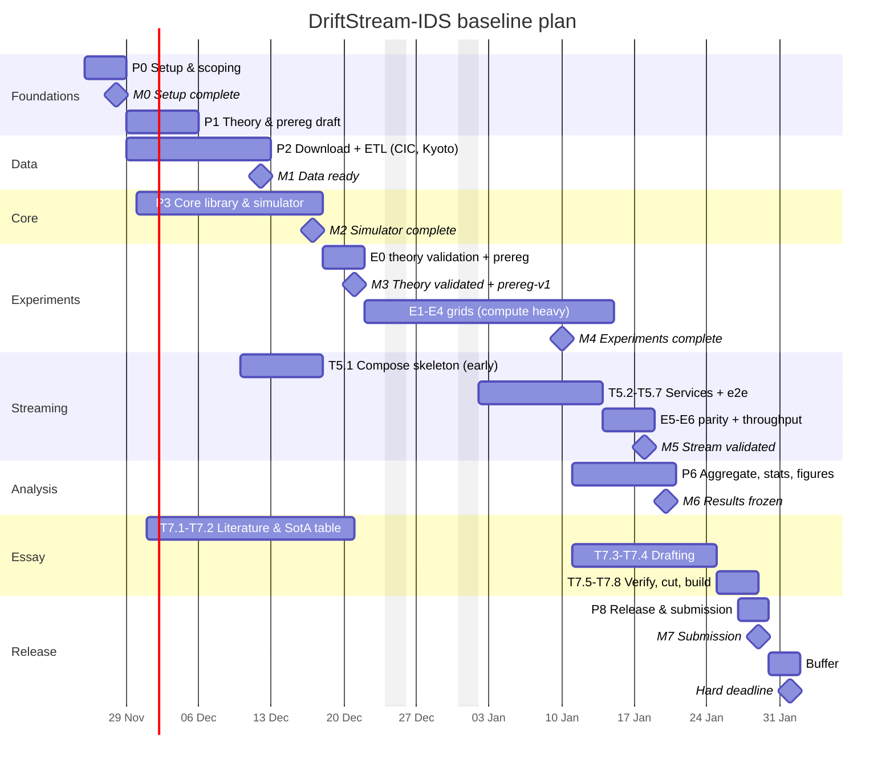

<!-- ROADMAP.md -->

# DriftStream-IDS — ROADMAP

> **What this document is:** the execution plan and the living status of the
> project. It covers the phases, tasks, milestones, acceptance criteria,
> timeline, risks, the essay production plan and a dated status log.
>
> **Companion documents:** `ARCHITECTURE.md` (design and scientific model),
> `PROJECT_STRUCTURE.md` (repository map and conventions).
>
> **Language policy:** all deliverables are in **English**.

---

## Table of contents

1. [How to use this roadmap (and resume work)](#1-how-to-use-this-roadmap-and-resume-work)
2. [Objectives and success criteria](#2-objectives-and-success-criteria)
3. [Assumptions and constraints](#3-assumptions-and-constraints)
4. [Milestones](#4-milestones)
5. [Phase plan (detailed tasks)](#5-phase-plan-detailed-tasks)
6. [Timeline and critical path](#6-timeline-and-critical-path)
7. [Essay production plan](#7-essay-production-plan)
8. [Source and claim verification checklist](#8-source-and-claim-verification-checklist)
9. [Risk register](#9-risk-register)
10. [Scope control (MoSCoW and stretch goals)](#10-scope-control-moscow-and-stretch-goals)
11. [Definition of Done](#11-definition-of-done)
12. [Working rhythm and document-sync ritual](#12-working-rhythm-and-document-sync-ritual)
13. [Status log](#13-status-log)
14. [Open questions](#14-open-questions)

---

## 1. How to use this roadmap (and resume work)

- Every task has an ID (`T<phase>.<n>`), a priority (**P0** must, **P1** should,
  **P2** could), an estimate, its dependencies and acceptance criteria (AC).
- Completed tasks are marked ✅ next to their ID (◐ = done locally, AC still
  pending an external step). At the end of each work session, add one line to
  the **Status log** (§13) and update **Current position** below.
- When the plan changes, edit the affected phase **and** add a log entry saying
  why. Never silently delete tasks: mark them `~~struck~~` with a reason.

### Current position

| Field                  | Value                                                                         |
| ---------------------- | ----------------------------------------------------------------------------- |
| Current phase          | **Phase 0 — Setup and scoping** (T0.1–T0.6 done)                              |
| Next task              | T0.7 (Kyoto 2007–2009 monthly download) → T1.1 → T1.2                         |
| Last milestone reached | — (M0 pending: first push to GitHub with CI green)                            |
| Blockers               | Repository not yet pushed; Q4 (preprints) still open, not blocking until T7.1 |

### Continuation prompt template

```text
Continue DriftStream-IDS. Current phase: <N>. Task: T<N.M>.
Done since last session: <…>. Problems: <…>.
Deliver: <code | config | test | doc section | essay section>.
```

Short forms are fine, e.g. `Continue with T3.4` or
`Next task, same conventions`.

---

## 2. Objectives and success criteria

### 2.1 Objectives

| ID  | Objective                                                                                                                                                                                                    |
| --- | ------------------------------------------------------------------------------------------------------------------------------------------------------------------------------------------------------------ |
| O1  | Answer the RQ with an analytic model **and** empirical evidence (`ARCHITECTURE.md` §2)                                                                                                                       |
| O2  | Deliver a 9-page (~2,500 words) essay that follows the course structure exactly (Title/Abstract → Intro → SotA → Bottleneck → Prognosis → Conclusion) with 12–15 high-quality sources, mainly from 2021–2026 |
| O3  | Demonstrate practical validity with a running Kafka–Spark pipeline that reproduces the simulator's results                                                                                                   |
| O4  | Produce a portfolio-grade, reproducible repository (one-command setup, CI, pinned environment, documented results)                                                                                           |
| O5  | Connect the technical findings to governance (NIS2, CRA, AI Act, ISO/IEC 42001, NIST CSF 2.0), as required by the course objectives                                                                          |

### 2.2 Success criteria (project-level)

- [ ] H1–H4 each receive a pre-registered decision (supported / not supported),
      with statistics in `results/aggregated/hypotheses.json`.
- [ ] Figure 1 (theory vs. empirical) and Table 2 (D×B regret) exist and are
      reproducible with `make figures tables`.
- [ ] E5 parity: mean absolute Δ windowed macro-F1 ≤ 0.01 at a 1 s trigger.
- [ ] The essay is ≤ 9 pages A4 and ~2,500 words (excluding references), with
      12–15 verified sources, and every number traces to a run.
- [ ] A fresh clone reproduces E0 and a reduced E1 with documented commands.

---

## 3. Assumptions and constraints

| Item                | Assumption / confirmed value                                                                                                                                                                                               |
| ------------------- | -------------------------------------------------------------------------------------------------------------------------------------------------------------------------------------------------------------------------- |
| Start date          | Wednesday 2026-11-25                                                                                                                                                                                                       |
| Submission deadline | **Monday 2027-02-01** (confirmed, Q1). Re-baselined plan: submit on **Friday 2027-01-29**, keeping 2027-01-30 → 2027-02-01 as buffer. The baseline 10-week plan fits; the compressed plan (§6.3) stays as a fallback only. |
| Effort              | ~15–20 h/week                                                                                                                                                                                                              |
| Hardware            | **Confirmed (Q5):** laptop with Intel Core i9 (20 cores), 32 GB RAM, NVIDIA RTX 5060 (8 GB VRAM). The GPU is not used (River and scikit-learn HGB are CPU-only). Free disk still to check: ≥ 60 GB needed                  |
| Tooling             | `uv`, Ruff (line length 80), Python 3.11, Docker Compose, `# %%` notebooks                                                                                                                                                 |
| Data access         | CIC-IDS2017 corrected (DistriNet). Kyoto 2006+: `https://www.takakura.com/Kyoto_data/new_data201704/` covers 2006-11 → 2015-12 as yearly and monthly zip archives (Q6)                                                     |
| Holidays            | Reduced capacity 2026-12-24 → 2027-01-01 (planned buffer)                                                                                                                                                                  |
| Course format       | **Confirmed (Q2):** English essay, A4, delivered as **PDF**, built from Pandoc Markdown (LaTeX engine) with **BibTeX** (`essay/refs.bib`). CSL style: IEEE unless the course names another                                 |
| Repository          | **Confirmed (Q3):** the essay references the public repository `https://github.com/franjavi-upct-es/DriftStream-IDS`; it must be public (release `v1.0.0`) before submission                                               |

---

## 4. Milestones

| ID     | Milestone                                    | Baseline date                         | Exit criteria                                                                                                                    | Git tag                   |
| ------ | -------------------------------------------- | ------------------------------------- | -------------------------------------------------------------------------------------------------------------------------------- | ------------------------- |
| **M0** | Setup complete                               | 2026-11-28                            | Repo skeleton, `make setup lint typecheck test` green locally and in CI; the three docs committed                                | `m0-setup`                |
| **M1** | Data ready                                   | 2026-12-12                            | Both datasets processed; `driftstream data validate` passes; data cards written; `drift_onsets.json` plausible                   | `m1-data`                 |
| **M2** | Simulator complete                           | 2026-12-17                            | All P0 components implemented and tested; River parity and no-leak tests pass; throughput benchmark done; compute budget updated | `m2-simulator`            |
| **M3** | Theory validated and pre-registration frozen | 2026-12-21                            | E0 done; prediction error within AC; `docs/preregistration.md` frozen                                                            | `m3-theory`, `prereg-v1`  |
| **M4** | Simulation experiments complete              | 2027-01-10                            | E1–E4 (+ robustness runs) all `_DONE`; experiment cards updated                                                                  | `m4-experiments`          |
| **M5** | Streaming layer validated                    | 2027-01-18                            | E5 parity within AC; E6 measured; e2e smoke test green                                                                           | `m5-stream`               |
| **M6** | Results frozen                               | 2027-01-20                            | Hypothesis decisions, figures and tables final; no further result changes                                                        | `m6-results`              |
| **M7** | Submission                                   | 2027-01-29 (hard deadline 2027-02-01) | Essay PDF built, verified and submitted; repository public and released                                                          | `m7-submission`, `v1.0.0` |

> Re-baselined on 2026-11-25 after the deadline was confirmed (Q1): M5 −2 days,
> M6 −2 days, M7 −6 days (3 days of buffer before the hard deadline). M0–M4
> unchanged.

---

## 5. Phase plan (detailed tasks)

Estimates are in focused hours (h). "Deps" lists task IDs that must finish
first.

### Phase 0 — Setup and scoping (M0)

| ID      | Pri | Task                                                                                                                                                                                                             | Est.  | Deps | AC                                                                 |
| ------- | --- | ---------------------------------------------------------------------------------------------------------------------------------------------------------------------------------------------------------------- | ----- | ---- | ------------------------------------------------------------------ |
| T0.1 ✅ | P0  | Create the repository (private until release); `uv init`; Python 3.11; `pyproject.toml` as in PROJECT_STRUCTURE §15                                                                                              | 1 h   | —    | `uv sync` works                                                    |
| T0.2 ✅ | P0  | Configure Ruff (80), mypy, pytest markers, pre-commit, import-linter contracts                                                                                                                                   | 2 h   | T0.1 | `make lint typecheck` green                                        |
| T0.3 ◐  | P0  | CI workflow `ci.yml` (lint, types, unit/property tests)                                                                                                                                                          | 1 h   | T0.2 | CI green on `main` (every step passes locally; pending first push) |
| T0.4 ✅ | P0  | Directory skeleton (PROJECT_STRUCTURE §2), Hydra config tree with placeholder groups, Typer CLI stub with all commands returning "not implemented"                                                               | 3 h   | T0.1 | `uv run driftstream --help` lists the commands                     |
| T0.5 ✅ | P0  | Docs skeleton: ADR template + ADR-001…013 stubs, `preregistration.md` draft header, `lab_notebook.md`, `decision_log.md`, experiment card stubs E0–E6                                                            | 2 h   | T0.4 | Files exist and are linked from README                             |
| T0.6 ✅ | P0  | Confirm course constraints: deadline, file format, citation style, whether a repository link/appendix is allowed, whether preprints count as sources (Q1–Q4)                                                     | 0.5 h | —    | Answers recorded in §14 and §3 (Q4 still open, needed by T7.1)     |
| T0.7    | P1  | Start the Kyoto download early (it is the longest I/O task), see T2.3: the 36 **monthly** archives `2007/200701.zip` … `2009/200912.zip` (≈ 3.9 GB zipped in total), so a failed transfer only repeats one month | 0.5 h | —    | Download running                                                   |

### Phase 1 — Theory and pre-registration draft (feeds M3)

| ID   | Pri | Task                                                                                                                                                                 | Est. | Deps | AC                                              |
| ---- | --- | -------------------------------------------------------------------------------------------------------------------------------------------------------------------- | ---- | ---- | ----------------------------------------------- |
| T1.1 | P0  | Write the derivations of ARCHITECTURE §4 as `docs/theory.md` (assumptions A1–A4, bounds, policy refinements, falsifiers)                                             | 4 h  | —    | Every formula has a stated assumption and units |
| T1.2 | P0  | Implement `theory/adwin_replay.py`: numerical `n*` from River's ADWIN cut condition (`delta`, `clock`, `min_window_length`, `grace_period`)                          | 4 h  | T0.4 | `n*` monotone in Δε and δ (unit tests)          |
| T1.3 | P0  | Implement `theory/bounds.py`: `tau_det_sup`, `tau_det_unsup`, `tau_rec` per policy, `regret`                                                                         | 4 h  | T1.2 | Unit tests incl. edge cases (`D = 0`, `B = 1`)  |
| T1.4 | P0  | Draft `docs/preregistration.md`: H1–H5, decision rules, primary metrics, exclusions (tiny CIC families), seeds, analysis plan (ARCHITECTURE §12), deviations section | 3 h  | T1.1 | Draft reviewed against ARCHITECTURE §2.3        |
| T1.5 | P1  | Sensitivity plan: ADWIN δ ∈ {0.0002, 0.002, 0.02}; KS `w_test` ∈ {500, 1000, 2000} (run on E0 only)                                                                  | 1 h  | T1.4 | Added to `e0_theory.yaml`                       |

### Phase 2 — Data acquisition and ETL (M1)

| ID   | Pri | Task                                                                                                                                                                                                                                                                        | Est. | Deps       | AC                                                                    |
| ---- | --- | --------------------------------------------------------------------------------------------------------------------------------------------------------------------------------------------------------------------------------------------------------------------------- | ---- | ---------- | --------------------------------------------------------------------- |
| T2.1 | P0  | Download CIC-IDS2017 corrected (DistriNet); write `data/CHECKSUMS.raw`; start `docs/data_cards/cicids2017.md`                                                                                                                                                               | 2 h  | T0.4       | Checksums recorded                                                    |
| T2.2 | P0  | `etl/cicids2017.py`: UTC/AM-PM checks, label mapping with `attempted_policy`, identifier removal, within-second dedup, warm-up-only imputation, sort + `flow_id`, Parquet by day                                                                                            | 6 h  | T2.1       | `validate` passes; duplicate counts logged                            |
| T2.3 | P0  | Kyoto 2006+: estimate the volume of the 2007–2009 window **before** the full download (zipped: 2007 = 633 MB, 2008 = 1,070 MB, 2009 = 2,155 MB; unzipped size to measure on the first month); download; checksums; data card listing the days the provider marks as missing | 3 h  | T0.7       | Files complete; zipped and unzipped sizes and missing days documented |
| T2.4 | P0  | `etl/spark_kyoto_etl.py` (PySpark): `event_time` from file date + `Start_Time`, UTC normalisation, label mapping (1 / −1 / −2), **leakage removal** (IDS/Malware/Ashula columns, IPs, source port), hash-based sampling to ≈1.5 M sessions, Parquet by month                | 8 h  | T2.3       | `validate` passes; leakage asserts pass                               |
| T2.5 | P0  | `etl/onsets.py`, `etl/stats.py`, `etl/validate.py` (monotonic time, schema, no-leak, class ratios)                                                                                                                                                                          | 3 h  | T2.2, T2.4 | `drift_onsets.json` lists the families on the expected days           |
| T2.6 | P0  | Test fixtures `cic_sample.csv`, `kyoto_sample.txt` + `test_etl_*_small.py`                                                                                                                                                                                                  | 2 h  | T2.2, T2.4 | Integration tests green                                               |
| T2.7 | P1  | EDA notebooks `01_eda_cicids2017.py`, `02_eda_kyoto2006.py`: λ(t), class ratio over time, family timeline, monthly feature shift (Kyoto)                                                                                                                                    | 4 h  | T2.5       | Findings in `lab_notebook.md`                                         |
| T2.8 | P1  | Feature profiles `default` / `strict` (`feature_profile.json`)                                                                                                                                                                                                              | 1 h  | T2.5       | Both profiles load in `data/features.py`                              |

### Phase 3 — Core library and simulator (M2)

| ID    | Pri | Task                                                                                                                                     | Est. | Deps       | AC                                                                                |
| ----- | --- | ---------------------------------------------------------------------------------------------------------------------------------------- | ---- | ---------- | --------------------------------------------------------------------------------- |
| T3.1  | P0  | `core/`: types, interfaces, actions, in-memory registry, label-access guard, errors                                                      | 4 h  | T0.4       | mypy strict passes                                                                |
| T3.2  | P0  | `seeds.py`: `SeedSequence` spawning per component                                                                                        | 1 h  | T3.1       | Same seed → same child seeds                                                      |
| T3.3  | P0  | `selection/`: token bucket (with burst), `random`, `uncertainty` (variable uncertainty), `hybrid(ρ)`                                     | 5 h  | T3.1       | Prefix-invariant property test; spending rate → B                                 |
| T3.4  | P0  | `oracle/`: `constant` and `lognormal` delay models; heap-based `LabelOracle`                                                             | 3 h  | T3.1       | Causality property test; mean delay within tolerance                              |
| T3.5  | P0  | `learners/`: `static`, `arf` (River), `batch` (HGB sliding window), serialization                                                        | 5 h  | T3.1       | Snapshot/restore round-trip test                                                  |
| T3.6  | P0  | `detectors/`: `adwin` (random-substream errors), `ks_scores` (persistence, reference re-capture)                                         | 4 h  | T3.1       | Detect synthetic change; false-alarm rate within tolerance on a stationary stream |
| T3.7  | P0  | `policies/`: `continuous`, `periodic`, `on_detect_sup`, `on_detect_unsup`                                                                | 4 h  | T3.1       | Pure-function tests                                                               |
| T3.8  | P0  | `simulate/`: events, engine (ARCHITECTURE §7), builder (with the policy-pairing table), runner (skip-if-done, `_DONE`)                   | 8 h  | T3.3–T3.7  | Determinism test passes                                                           |
| T3.9  | P0  | `evaluation/`: prequential windows, metrics, onsets (delay, rate, false alarms), recovery (censoring), regret pairing, writer + manifest | 8 h  | T3.8       | Hand-computed examples pass                                                       |
| T3.10 | P0  | `data/synthetic.py`: Gaussian mean-shift stream with known Δε; SEA + `ConceptDriftStream` wrapper                                        | 3 h  | T3.1       | Generated Δε matches the target ± tolerance                                       |
| T3.11 | P0  | Integration tests: River delayed-evaluation parity at `B = 1`; no-label-leak (AST + runtime guard)                                       | 4 h  | T3.8, T3.9 | Both green                                                                        |
| T3.12 | P0  | `make bench`: measure flows/s for `arf` and `batch` on CIC and Kyoto; update ARCHITECTURE §11.8 and choose the CIC `subsample`           | 2 h  | T3.8, T2.5 | Compute budget recorded in the decision log                                       |
| T3.13 | P1  | `policies/budget_burst.py`, `policies/gate.py`; `detectors/ddm.py`                                                                       | 5 h  | T3.7       | Burst never exceeds the long-run budget (property test); gate defer logic tested  |
| T3.14 | P2  | `detectors/mmd_features.py` (random Fourier features + permutation test)                                                                 | 4 h  | T3.6       | Detects a Gaussian shift in E0                                                    |
| T3.15 | P1  | Optional MLflow tracking in simulate mode (`track_mlflow=true`)                                                                          | 2 h  | T3.9       | Runs visible in the MLflow UI                                                     |

### Phase 4 — Simulation experiments (M3, M4)

| ID    | Pri | Task                                                                                                                             | Est.          | Deps               | AC                                                                                                            |
| ----- | --- | -------------------------------------------------------------------------------------------------------------------------------- | ------------- | ------------------ | ------------------------------------------------------------------------------------------------------------- |
| T4.1  | P0  | **E0** theory validation (Gaussian + SEA control; factor grid in ARCHITECTURE §11.2; 10 seeds)                                   | 4 h + compute | T1.3, T3.10, T3.11 | Median relative error of the τ_rec prediction ≤ 25 %; H1 slope CI contains 1; SEA not detected by `ks_scores` |
| T4.2  | P0  | Resolve E0 discrepancies (theory or code), document them in `lab_notebook.md`; **freeze the pre-registration** → tag `prereg-v1` | 3 h           | T4.1               | M3 reached                                                                                                    |
| T4.3  | P0  | **E1** CIC grid (720 runs + references + log-normal variant)                                                                     | 2 h + compute | T4.2, T2.5         | All runs `_DONE`                                                                                              |
| T4.4  | P0  | **E2** Kyoto grid (same structure, Kyoto delays)                                                                                 | 2 h + compute | T4.2, T2.5         | All runs `_DONE`                                                                                              |
| T4.5  | P0  | **E3** injected-drift ablation + A-ATT (attempted labels) + A-FEAT (`strict` features)                                           | 3 h + compute | T4.2               | All runs `_DONE`                                                                                              |
| T4.6  | P1  | **E4** policy comparison (continuous, periodic, ODS, ODU, burst k ∈ {2, 5, 10}, ± gate; 10 seeds) + D sweep for burst            | 3 h + compute | T3.13, T4.2        | All runs `_DONE`                                                                                              |
| T4.7  | P1  | Robustness: ADWIN δ / KS window sensitivity (E0 subset)                                                                          | 1 h + compute | T4.1               | Reported in the experiment card                                                                               |
| T4.8  | P2  | Stretch: label-noise factor η ∈ {0, 0.05, 0.10} on E1 core cells                                                                 | 3 h + compute | T4.3               | Card + one paragraph of results                                                                               |
| T4.9  | P2  | Stretch: cross-dataset shift UNSW-NB15 → CIC (common feature subset)                                                             | 6 h + compute | T4.3               | Card + result                                                                                                 |
| T4.10 | P0  | Update experiment cards E0–E4 with status, run counts, key result and caveats                                                    | 1 h           | T4.3–T4.6          | Cards complete → M4 reached                                                                                   |

### Phase 5 — Streaming layer: Kafka–Spark (M5)

> The infrastructure skeleton (T5.1) starts **early (mid-December)**, so version
> incompatibilities show up long before E5.

| ID    | Pri | Task                                                                                                                                                                                                                                      | Est.           | Deps            | AC                                                                  |
| ----- | --- | ----------------------------------------------------------------------------------------------------------------------------------------------------------------------------------------------------------------------------------------- | -------------- | --------------- | ------------------------------------------------------------------- |
| T5.1  | P0  | `deploy/docker/docker-compose.yml` (profile `core`): Kafka (KRaft), `kafka-init` (topics, ARCHITECTURE §13.3), Spark master/worker with a matching `spark-sql-kafka` package, MLflow; pin images in `IMAGES.lock`; all ports on 127.0.0.1 | 6 h            | T0.4            | `make stream-up` brings every service to healthy on a 16 GB machine |
| T5.2  | P0  | `deploy/schemas.py`, `topics.py`, `kafka_io.py` (idempotent producer, LRU dedup consumer), `clock.py`                                                                                                                                     | 4 h            | T3.1            | Schema round-trip tests                                             |
| T5.3  | P0  | `replayer.py`: event-time ordered replay at speed ×S, strips labels, emits `sim.clock`                                                                                                                                                    | 3 h            | T5.2, T2.5      | Ordered output on a 1-partition topic                               |
| T5.4  | P0  | `scorer_job.py`: Spark Structured Streaming, `foreachBatch`, champion reload on version change, checkpointing                                                                                                                             | 6 h            | T5.1, T3.5      | Scores a replayed slice; the model version is recorded per score    |
| T5.5  | P0  | Services: `selector_service`, `oracle_service` (ground truth from Parquet), `updater_service` (+ MLflow registry), `drift_monitor_service`, `policy_service`, all reusing the core classes via `simulate/builder.py`                      | 10 h           | T5.2, T3.3–T3.7 | Each service has a unit test with a fake broker                     |
| T5.6  | P0  | `metrics_sink.py` + `driftstream stream compare` (evaluation module reused offline)                                                                                                                                                       | 4 h            | T5.5, T3.9      | `parity.json` produced                                              |
| T5.7  | P0  | e2e smoke test (`tests/e2e/test_stream_smoke.py`): 1k flows end-to-end                                                                                                                                                                    | 3 h            | T5.3–T5.6       | Green                                                               |
| T5.8  | P0  | **E5** parity: CIC 1 h slice and Kyoto 30-day slice; triggers 1 s / 5 s / 30 s                                                                                                                                                            | 3 h + run time | T5.7, T4.3      | Mean abs Δ macro-F1 ≤ 0.01 at 1 s; gap reported for 5/30 s          |
| T5.9  | P1  | **E6** throughput/latency: partitions 1/3/6; `foreachBatch` vs. `mapInPandas` (ADR-008); identify the bottleneck service                                                                                                                  | 4 h + run time | T5.8            | `tab3_stream_perf.md`                                               |
| T5.10 | P2  | Prometheus + Grafana dashboard (profile `monitoring`); screenshot for the README                                                                                                                                                          | 4 h            | T5.7            | Dashboard shows lag, throughput, alarms                             |

### Phase 6 — Analysis, figures and tables (M6)

| ID   | Pri | Task                                                                                                                                                                                      | Est.  | Deps        | AC                                          |
| ---- | --- | ----------------------------------------------------------------------------------------------------------------------------------------------------------------------------------------- | ----- | ----------- | ------------------------------------------- |
| T6.1 | P0  | `analysis/aggregate.py` for E0–E6                                                                                                                                                         | 3 h   | T4.10, T5.8 | Aggregated Parquet tables                   |
| T6.2 | P0  | `analysis/stats.py` + `hypotheses.py`: OLS (cluster-robust), Friedman, Wilcoxon–Holm, bootstrap, Kaplan–Meier, Cliff's δ                                                                  | 6 h   | T6.1        | `hypotheses.json` with a decision per H1–H4 |
| T6.3 | P0  | Figures: fig1 theory vs. empirical; fig2 D×B regret heatmap; fig3 CIC recovery timeline; fig4 policies; fig5 stream parity (consistent style, colour-blind-safe palette, A4 column width) | 6 h   | T6.2        | `make figures` regenerates all of them      |
| T6.4 | P0  | Tables: tab1 SotA (from `docs/sources/`), tab2 D×B regret, tab3 stream performance (Markdown + LaTeX)                                                                                     | 3 h   | T6.2, T7.2  | `make tables` regenerates all of them       |
| T6.5 | P0  | Sanity review: oracle ≥ every configuration; static is the worst; labels spent ≤ budget; no negative recovery times; anomalies explained                                                  | 2 h   | T6.3        | Checklist ticked in `lab_notebook.md`       |
| T6.6 | P0  | Freeze results → tag `m6-results`                                                                                                                                                         | 0.5 h | T6.5        | M6 reached                                  |

### Phase 7 — Essay (runs in parallel from Phase 1)

| ID   | Pri | Task                                                                                                                                                         | Est. | Deps       | AC                                      |
| ---- | --- | ------------------------------------------------------------------------------------------------------------------------------------------------------------ | ---- | ---------- | --------------------------------------- |
| T7.1 | P0  | Literature collection: 20–25 candidates in `docs/sources/reading_list.md`, clustered **by idea** (§7.3); select 12–15                                        | 8 h  | —          | Selection meets the source mix in §7.3  |
| T7.2 | P0  | Data extraction for the 6-study SotA table (§7.4), read from the papers themselves, especially the "immediate labels?" column                                | 4 h  | T7.1       | Every cell has a page/section reference |
| T7.3 | P0  | Outline with word and page budgets (§7.1) in `essay/essay.md`                                                                                                | 1 h  | T7.1       | Outline committed                       |
| T7.4 | P0  | Draft Section 3 (Bottleneck) first, then 2 → 4 → 1 → 5 → abstract → title (§7.2)                                                                             | 14 h | T6.3, T7.3 | Full draft ≤ 2,700 words                |
| T7.5 | P0  | Verification pass (§8): every reference, legal date and number                                                                                               | 3 h  | T7.4       | Checklist complete                      |
| T7.6 | P0  | Rubric self-review (§7.5) and cut to ~2,500 words / 9 pages                                                                                                  | 3 h  | T7.5       | All rubric items ticked                 |
| T7.7 | P1  | External read by a classmate or tutor; incorporate feedback                                                                                                  | 2 h  | T7.6       | Feedback logged                         |
| T7.8 | P0  | Build the final **PDF** (Pandoc + LaTeX engine + `refs.bib`); check pagination, figure legibility at 100 % zoom, fonts and that the repository link resolves | 1 h  | T7.6       | `essay/build/essay.pdf`                 |

### Phase 8 — Release and submission (M7)

| ID   | Pri | Task                                                                                                                                                                             | Est.  | Deps | AC                                                          |
| ---- | --- | -------------------------------------------------------------------------------------------------------------------------------------------------------------------------------- | ----- | ---- | ----------------------------------------------------------- |
| T8.1 | P0  | README: problem, headline result, figure 1, quick start, how to reproduce, citation                                                                                              | 2 h   | T6.6 | Reviewed                                                    |
| T8.2 | P0  | Clean-clone reproduction: `git clone → make setup data e0` + a reduced E1 on another machine or a fresh container                                                                | 3 h   | T8.1 | Same E0 summary hashes                                      |
| T8.3 | P0  | `CITATION.cff`, LICENSE, tags `m7-submission` and `v1.0.0`; make `github.com/franjavi-upct-es/DriftStream-IDS` public; release assets (PDF, figures, tables, aggregated results) | 1 h   | T8.2 | Public release whose URL matches the one cited in the essay |
| T8.4 | P0  | Submit the essay                                                                                                                                                                 | 0.5 h | T7.8 | Confirmation received                                       |
| T8.5 | P2  | Zenodo DOI; short portfolio write-up                                                                                                                                             | 2 h   | T8.3 | DOI badge in the README                                     |

---

## 6. Timeline and critical path

### 6.1 Baseline Gantt (10 weeks, re-baseline once the deadline is known)



Drafting starts on 2027-01-11 with Section 3 (Bottleneck), using the E0 results
and the first E1/E2 aggregates; numbers are re-checked at M6.

### 6.2 Critical path

```
T0.1 → T0.4 → T3.1 → T3.3/T3.4/T3.5/T3.6/T3.7 → T3.8 → T3.9 → T3.11
     → T4.1 (E0) → T4.2 (prereg-v1) → T4.3/T4.4 (E1/E2 compute)
     → T6.1 → T6.2 → T6.3 → T7.4 (draft) → T7.5 → T7.6 → T7.8 → T8.4
```

**Parallel tracks off the critical path:** data ETL (Phase 2, must finish before
T4.3), the streaming skeleton (T5.1 from mid-December), literature (T7.1–T7.2
from December).

**Longest single risks on the path:** Kyoto download/ETL (start in week 1) and
E1/E2 compute (start immediately after `prereg-v1`; run overnight).

### 6.3 Compressed plan (fallback only)

> **Not active.** The confirmed deadline (2027-02-01) fits the baseline.
> Activate this plan if slippage at the weekly review exceeds 5 days.

Keep every **P0** item and drop or defer the rest, in this order:

1. Drop T3.14 (MMD), T5.10 (Grafana), T4.8–T4.9 (stretch), T8.5.
2. Reduce E1/E2 seeds to 3 (keep 10 only for the H1/H3 headline cells); apply
   compute reductions R1–R3 (ARCHITECTURE §11.8).
3. E4 reduced to ODS vs. ODU vs. burst (k = 5), without the gate.
4. E5 only on CIC with a 1 s and a 5 s trigger; E6 with partitions 1 and 3.

| Week | Focus                                                    |
| ---- | -------------------------------------------------------- |
| 1    | Phase 0, T1.1–T1.3, T2.1–T2.2, Kyoto download, T3.1–T3.4 |
| 2    | T2.4–T2.6, T3.5–T3.11, T5.1 skeleton                     |
| 3    | E0, prereg freeze, start E1/E2 (overnight), T5.2–T5.5    |
| 4    | E3/E4, T5.6–T5.8 (E5), T6.1–T6.2                         |
| 5    | Figures/tables, essay draft (Sections 3 → 2 → 4)         |
| 6    | Sections 1/5, verification, cut, build, release, submit  |

---

## 7. Essay production plan

### 7.1 Word and page budget (course structure)

| Part                       | Course requirement                                                                        | Pages | Words      | Visuals                                                                |
| -------------------------- | ----------------------------------------------------------------------------------------- | ----- | ---------- | ---------------------------------------------------------------------- |
| Title + abstract           | Title and a 100-word summary at the top of page 1                                         | 0.5   | 100        | —                                                                      |
| 1. Introduction & Approach | Problem, one sharp RQ, 2–3-sentence method                                                | 1     | 300        | —                                                                      |
| 2. State of the Art        | Top 2–3 approaches, newest breakthrough (last 1–2 years), comparison table of 5–6 studies | 3     | 800        | **Table 1** (6 studies)                                                |
| 3. The Bottleneck          | Exact weak spots, then the gap                                                            | 1.5   | 450        | **Figure 1** (theory vs. empirical), **Table 2** (D×B regret, compact) |
| 4. Future Prognosis        | Key drivers, 3–5-year outlook, 2–3 actionable takeaways                                   | 2     | 550        | Optional mini-table of catalysts with dates                            |
| 5. Conclusion              | Direct answer to the RQ, one specific next study                                          | 1     | 300        | —                                                                      |
| References                 | 12–15 sources (outside the 9 pages)                                                       | —     | —          | —                                                                      |
| **Total**                  |                                                                                           | **9** | **≈2,500** | 1 figure + 2 tables (+1 optional)                                      |

### 7.2 Writing order and content per section

1. **Section 3 — Bottleneck (written first, because it is the core):**
    - Weak spot 1: the immediate-label assumption in drift-adaptation
      evaluations (evidence: Table 1 column).
    - Weak spot 2: the analytic floor `D + m_a/(Bλ)` and Figure 1.
    - Weak spot 3: data validity (corrected datasets, temporal splits) and the
      gap between lab and SOC.
    - **The Gap** (one paragraph): "No adaptation strategy that waits for labels
      can recover faster than the verification pipeline; current evaluations
      hide this."
2. **Section 2 — State of the Art:**
    - (a) Supervised detection + incremental learning (ADWIN/DDM, ARF;
      INSOMNIA).
    - (b) Unsupervised shift detection with few labels (OWAD; ReCDA).
    - (c) Continual/active learning under budgets (Chen et al. 2023).
    - Newest work: Apruzzese 2026 SoK and 2025–2026 papers found in T7.1.
    - Close with Table 1, organised **by idea, not by author**.
3. **Section 4 — Prognosis:**
    - Drivers with dates: NIS2 reporting (24 h/72 h), CRA reporting from 11 Sep
      2026 and full application in Dec 2027, AI Act Art. 15 + post-market
      monitoring (dates after the Digital Omnibus, verified), ISO/IEC 42001
      adoption, analyst scarcity.
    - Outlook (3–5 years, falsifiable, with an observable indicator): delay- and
      budget-aware evaluation becomes the norm at top venues and in procurement;
      label-free adaptation + promotion gates move into MLOps; LLM-assisted
      triage shortens `D` but adds label noise.
    - Evidence from E4 (burst/gate) and E5/E6 (feasibility).
    - Takeaways: report performance as a function of (D, B); treat analyst
      verification time as a security KPI; gate model promotions.
4. **Section 1 — Introduction:** problem → why now (catalysts) → RQ → method
   (source filter 2021–2026 peer-reviewed + policy; analytic model; reproducible
   experiments).
5. **Section 5 — Conclusion:** a direct answer with the headline numbers; next
   study: measure the empirical label-delay distribution in a real SOC for at
   least 3 months and re-run the grid with the `empirical` delay model.
6. **Abstract** (100 words) and **title**, last.

### 7.3 Source plan (12–15, mainly 2021–2026)

| Idea cluster                        | Target count | Candidates (verify before use)                                                                                         |
| ----------------------------------- | ------------ | ---------------------------------------------------------------------------------------------------------------------- |
| Evaluation validity in ML security  | 2–3          | Arp et al. 2022; Engelen et al. 2021 / Liu et al. 2022; Apruzzese et al. 2023                                          |
| Drift adaptation for NIDS/security  | 4–5          | Andresini et al. 2021 (INSOMNIA); Han et al. 2023 (OWAD); Chen et al. 2023; Yang et al. 2024 (ReCDA); EAAI 2024 survey |
| Latest NIDS research direction      | 1            | Apruzzese 2026 SoK (ASIA CCS '26)                                                                                      |
| Verification latency (foundational) | 1            | Grzenda et al. 2020 (counts as foundational; at most 2–3 sources older than 2021 overall)                              |
| SOC reality / analyst burden        | 1            | Alahmadi et al. 2022, _99% False Positives_ (USENIX Security 2022)                                                     |
| Policy / standards                  | 2–3          | NIS2; AI Act + Digital Omnibus; CRA; ISO/IEC 42001                                                                     |
| Industry/threat data                | 1            | ENISA Threat Landscape 2025                                                                                            |

**Rules:** ≥ 8 peer-reviewed; ≤ 3 older than 2021 (flagged as foundational);
preprints only for the "newest breakthrough" and balanced by peer-reviewed
sources; no vendor marketing as evidence for a central claim.

### 7.4 Table 1 — State-of-the-art comparison (template)

| Study (year, venue)                   | Approach family                           | Data & temporal span | Immediate labels assumed? | Delay modelled? | Label budget | Key metric/result | Main limitation |
| ------------------------------------- | ----------------------------------------- | -------------------- | ------------------------- | --------------- | ------------ | ----------------- | --------------- |
| Andresini et al. 2021 (AISec)         | Pseudo-labelling + incremental            | _extract_            | _extract_                 | _extract_       | _extract_    | _extract_         | _extract_       |
| Han et al. 2023 (NDSS, OWAD)          | Unsupervised shift detection + few labels |                      |                           |                 |              |                   |                 |
| Chen et al. 2023 (USENIX Sec)         | Continual + active learning               |                      |                           |                 |              |                   |                 |
| Yang et al. 2024 (KDD, ReCDA)         | Representation adaptation                 |                      |                           |                 |              |                   |                 |
| Apruzzese et al. 2023 (EuroS&P)       | Evaluation framework                      |                      |                           |                 |              |                   |                 |
| Engelen et al. 2021 / Liu et al. 2022 | Data validity                             |                      |                           |                 |              |                   |                 |

Every cell is filled from the paper itself, with a section/page reference stored
in `docs/sources/reading_list.md` (T7.2). **No cell is filled from memory or
secondary summaries.**

### 7.5 Rubric self-review checklist (from the course instructions)

- [ ] One very specific bottleneck, not a broad theme.
- [ ] No textbook definitions or history; expert reader assumed.
- [ ] Sources synthesised **by idea**, never listed author by author.
- [ ] Exactly one sharp RQ, stated in Section 1 and answered directly in
      Section 5.
- [ ] Method stated in 2–3 sentences (source filter + evaluation of trends).
- [ ] SotA: top 2–3 approaches + the newest breakthrough from the last 1–2
      years + a compact table of 5–6 studies.
- [ ] Bottleneck: explicit limits (technical, cost, legal, lack of real-world
      testing) + a one-paragraph gap.
- [ ] Prognosis tied **directly** to the gap; catalysts are concrete (law,
      technology, economics) with dates; a 3–5-year horizon; 2–3 actionable
      takeaways.
- [ ] Conclusion proposes **one** specific next study.
- [ ] 12–15 high-quality sources, mainly from the last 5 years.
- [ ] ≤ 9 pages A4, ~2,500 words excluding references; title + abstract on page
      1 with the Introduction directly below.
- [ ] Every number traceable to a run or a cited source.

---

## 8. Source and claim verification checklist

To be completed in T7.5 and recorded in `docs/sources/verification.md`.

| Item                                                                                              | Check against                            | Status |
| ------------------------------------------------------------------------------------------------- | ---------------------------------------- | ------ |
| Every bibliographic entry (authors, year, venue, pages, DOI)                                      | DBLP / Crossref / publisher page         | [ ]    |
| InjecAgent / StruQ / other ◐ references (only if used)                                            | Publisher pages                          | [ ]    |
| NIS2 Art. 21 and Art. 23 deadlines (24 h / 72 h)                                                  | EUR-Lex text of Directive (EU) 2022/2555 | [ ]    |
| CRA reporting obligations from 11 Sep 2026; full application 11 Dec 2027                          | EUR-Lex, Regulation (EU) 2024/2847       | [ ]    |
| AI Act high-risk dates after the Digital Omnibus (Reg. (EU) 2026/1744); Annex III point 2 wording | EUR-Lex consolidated text                | [ ]    |
| Whether an ML-NIDS can be high-risk under Annex III point 2 (argued, not assumed)                 | AI Act text + Commission guidelines      | [ ]    |
| ENISA Threat Landscape 2025 figures used                                                          | ENISA PDF                                | [ ]    |
| CIC-IDS2017 corrected: >20 % of traces reconstructed/relabelled                                   | Engelen et al. 2021                      | [ ]    |
| Arp et al.: pitfall prevalence figures                                                            | Arp et al. 2022                          | [ ]    |
| Chen et al.: F1 0.99 → 0.76 within 6 months (Android malware, cited as a neighbouring domain)     | Chen et al. 2023                         | [ ]    |
| Kyoto 2006+ label semantics (1 / −1 / −2) and column meanings                                     | Song et al. 2011 + dataset documentation | [ ]    |
| Dataset access URLs still valid                                                                   | Provider pages                           | [ ]    |

---

## 9. Risk register

| ID  | Risk                                                 | Likelihood                                                                    | Impact     | Mitigation                                                                                                                                                                 | Trigger / owner action                  |
| --- | ---------------------------------------------------- | ----------------------------------------------------------------------------- | ---------- | -------------------------------------------------------------------------------------------------------------------------------------------------------------------------- | --------------------------------------- |
| R1  | Deadline earlier than the baseline                   | Low (confirmed 2027-02-01)                                                    | High       | Re-baselined plan with 3 days of buffer; compressed plan (§6.3) as fallback                                                                                                | Slippage > 5 days at a weekly review    |
| R2  | Kyoto download slow, partial or the site unavailable | Medium                                                                        | High       | Start in week 1 (T0.7); download monthly archives (≈ 3.9 GB zipped for 2007–2009) and verify each; shorten the window (e.g. 2008 only) if needed; document any mirror used | Download not finished by 2026-12-05     |
| R3  | CIC corrected dataset link unavailable               | Low                                                                           | High       | Contact the authors; fallback: corrected CSE-CIC-IDS2018 (Liu et al. 2022), same pipeline                                                                                  | Download fails twice                    |
| R4  | Simulator too slow for the grid                      | Low–Medium (20 cores: E1 ≈ 2–3 h, E2 ≈ 6 h wall-clock at the §11.8 estimates) | Medium     | Benchmark early (T3.12); subsample; reductions R1–R4; overnight runs; optional Spark sweep runner                                                                          | Bench < 1,000 flows/s                   |
| R5  | Theory does not match E0                             | Medium                                                                        | Medium     | Treat it as a finding; revise the assumptions **before** `prereg-v1`; report the discrepancy                                                                               | Prediction error > 25 %                 |
| R6  | Kafka/Spark/connector version conflicts              | Medium                                                                        | Medium     | Skeleton in December (T5.1); pinned official images; smoke test                                                                                                            | Stack not healthy by 2026-12-17         |
| R7  | Parity not reached                                   | Medium                                                                        | Low–Medium | Analyse model-reload cadence and ordering; report the deployment gap honestly                                                                                              | Δ macro-F1 > 0.01 at 1 s                |
| R8  | Essay exceeds 2,500 words / 9 pages                  | High                                                                          | Medium     | Bottleneck written first; one figure; details pushed to the repository                                                                                                     | Draft > 2,700 words                     |
| R9  | Scope creep (stretch items before the core)          | Medium                                                                        | Medium     | MoSCoW (§10); stretch only after M6                                                                                                                                        | Any P2 task started before M6           |
| R10 | Citation errors or misattributed claims              | Medium                                                                        | High       | Verification checklist (§8); extract from primary sources                                                                                                                  | Any ◐ item unresolved in the final week |
| R11 | Legal dates change (AI Act amendments)               | Medium                                                                        | Medium     | Re-verify in the final week; cite the consolidated text with an access date                                                                                                | —                                       |
| R12 | Machine resources insufficient for the stack         | Low (32 GB RAM)                                                               | Medium     | Lower Spark worker memory; run Python services natively (outside Docker)                                                                                                   | OOM / swap during E5                    |
| R13 | ARF memory growth on long Kyoto streams              | Low                                                                           | Medium     | Monitor memory; limit tree size/`n_models`; checkpoint                                                                                                                     | RSS > 4 GB per run                      |
| R14 | Results look "too good" (hidden leak)                | Low                                                                           | High       | Leak tests; oracle sanity; per-family checks; `strict` feature ablation                                                                                                    | Static ≈ oracle, or recovery < D        |

---

## 10. Scope control (MoSCoW and stretch goals)

| Category                    | Items                                                                                                                                                                                                                                                                 |
| --------------------------- | --------------------------------------------------------------------------------------------------------------------------------------------------------------------------------------------------------------------------------------------------------------------- |
| **Must (P0)**               | Theory module; CIC + Kyoto ETL; simulator with `static`/`arf`/`batch`, `adwin`/`ks_scores`, `random`/`hybrid`, constant + log-normal delays, `continuous`/`periodic`/ODS/ODU; E0–E3; Kafka–Spark core stack; E5 parity; analysis + Figure 1 + Table 2; essay; release |
| **Should (P1)**             | DDM; budget burst; promotion gate; E4; E6; sensitivity analysis; MLflow tracking in simulate mode; EDA notebooks; external essay review                                                                                                                               |
| **Could (P2)**              | MMD detector; Grafana/Prometheus; Zenodo DOI; portfolio write-up                                                                                                                                                                                                      |
| **Stretch (only after M6)** | Label noise η (T4.8); cross-dataset UNSW-NB15 → CIC (T4.9); `empirical` delay model from published SOC statistics; LLM-as-weak-labeller arm                                                                                                                           |
| **Won't (this project)**    | Multi-class family classification as the main task; poisoning of the label channel (only discussed); production security hardening                                                                                                                                    |

---

## 11. Definition of Done

A **task** is done when:

- [ ] its code is typed, Ruff-clean (line length 80) and documented (Google
      docstrings with units);
- [ ] its tests exist and pass in CI (or locally for `stream`/`slow` tests);
- [ ] its configs exist, and no value is hard-coded;
- [ ] docs are updated where relevant (ADR, data/experiment card,
      PROJECT_STRUCTURE tree);
- [ ] it has a log line in §13.

An **experiment** is done when every run has `_DONE`, its card is updated, its
aggregated table exists and its anomalies are explained in `lab_notebook.md`.

The **project** is done when the success criteria in §2.2 are met and tag
`v1.0.0` exists.

---

## 12. Working rhythm and document-sync ritual

**Each session (start):** read "Current position" (§1) → pick the next task →
check its dependencies.

**Each session (end, about 5 minutes):**

1. Tick the completed tasks; update "Current position".
2. Add a status-log line (§13): date, what changed, next step, blockers.
3. If a file or directory was added, update `PROJECT_STRUCTURE.md` §2.
4. If a design decision changed, write or update an ADR and edit
   `ARCHITECTURE.md`.
5. Commit with `docs(roadmap): …`.

**Weekly (about 20 minutes):** compare progress with the Gantt; re-plan if
slippage exceeds 3 days; review the risk register; check the essay word count
once drafting starts.

**At each milestone:** tag, update the README, re-upload the three docs to the
project memory so future sessions start from the current state.

---

## 13. Status log

| Date       | Phase   | Change / result                                                                                                                                                                                                                                                                                                                                                                                                                                                                                                                                    | Next step                                                                                 | Blockers                                                 |
| ---------- | ------- | -------------------------------------------------------------------------------------------------------------------------------------------------------------------------------------------------------------------------------------------------------------------------------------------------------------------------------------------------------------------------------------------------------------------------------------------------------------------------------------------------------------------------------------------------- | ----------------------------------------------------------------------------------------- | -------------------------------------------------------- |
| 2026-11-24 | Scoping | Topic chosen: DriftStream-IDS narrowed to **verification latency × labelling budget** in streaming NIDS. Scope approved: CIC-IDS2017 corrected **and Kyoto 2006+ in the MVP**; **Kafka–Spark layer kept**. ARCHITECTURE, PROJECT_STRUCTURE and ROADMAP written.                                                                                                                                                                                                                                                                                    | T0.1 repository setup; T0.6 confirm the course constraints; T0.7 start the Kyoto download | Deadline and format unknown (Q1, Q2)                     |
| 2026-11-25 | Phase 0 | T0.1–T0.5 done: uv project (Python 3.11, 176 packages locked), Ruff/mypy/pytest/pre-commit/import-linter (4 contracts kept), `ci.yml` + `integration.yml`, 14 sub-packages, Hydra tree (all groups + E0–E6 compose), Typer CLI with every planned command (exit code 3 + task ID), ADR-001…013, prereg draft, lab notebook, decision log, experiment cards. `make check` green: 155 tests, 100 % coverage of the scaffold. Decisions logged: Hydra `# @package` must be line 1 (path comment on line 2); plugin's own joblib launcher config used. | Push to GitHub (CI green → T0.3, M0); T0.6 answers; T0.7 Kyoto download; T1.1             | Q1, Q2; ARCHITECTURE.md still to be copied into the repo |
| 2026-11-25 | Phase 0 | T0.6 done: deadline 2027-02-01 (plan re-baselined: M5 01-18, M6 01-20, M7 01-29 + 3-day buffer); PDF via Pandoc/LaTeX + BibTeX; essay cites `github.com/franjavi-upct-es/DriftStream-IDS`; hardware i9 20 cores / 32 GB; Kyoto 2006-11 → 2015-12 available, MVP window kept at 2007–2009 (≈ 3.9 GB zipped). README, `pyproject.toml` URLs, data README and decision log updated.                                                                                                                                                                   | T0.7 Kyoto monthly download; T1.1 theory derivations; push to GitHub for M0               | Q4 open (not blocking until T7.1); free disk unconfirmed |

---

## 14. Open questions

| ID  | Question                                                          | Why it matters                            | Status                                                                                                                                                                                                     |
| --- | ----------------------------------------------------------------- | ----------------------------------------- | ---------------------------------------------------------------------------------------------------------------------------------------------------------------------------------------------------------- |
| Q1  | What is the submission deadline?                                  | Baseline vs. compressed plan              | **Resolved 2026-11-25:** 2027-02-01; plan re-baselined (§4, §6.1)                                                                                                                                          |
| Q2  | Required file format (PDF/DOCX) and citation style?               | Essay build + CSL                         | **Resolved 2026-11-25:** PDF from Pandoc Markdown/LaTeX with BibTeX; IEEE CSL unless the course names another style                                                                                        |
| Q3  | May the essay reference a code repository or include an appendix? | Where experimental details go             | **Resolved 2026-11-25:** yes, the repository is referenced: `https://github.com/franjavi-upct-es/DriftStream-IDS` (to be created). Appendix: not needed                                                    |
| Q4  | Do arXiv preprints count towards the 12–15 sources?               | Source mix                                | Open (needed before T7.1). Until answered, the §7.3 rule applies: preprints only for the newest breakthrough                                                                                               |
| Q5  | Available hardware (cores, RAM, disk)?                            | Compute budget, Docker resources          | **Resolved 2026-11-25:** i9 20 cores, 32 GB RAM, RTX 5060 8 GB (not used). Free disk still to confirm (≥ 60 GB)                                                                                            |
| Q6  | Which Kyoto window is actually downloadable (years available)?    | E2 design (default 2007–2009)             | **Resolved 2026-11-25:** 2006-11 → 2015-12 at `takakura.com/Kyoto_data/new_data201704/`. MVP window stays 2007–2009 (≈ 3.9 GB zipped); later years (≈ 15.7 GB zipped, 2010–2015) are a stretch option only |
| Q7  | `attempted_policy` default (`benign` vs. `attack`)                | Labels in CIC; ablation A-ATT covers both | Decided: `benign` default, ablation reported                                                                                                                                                               |
